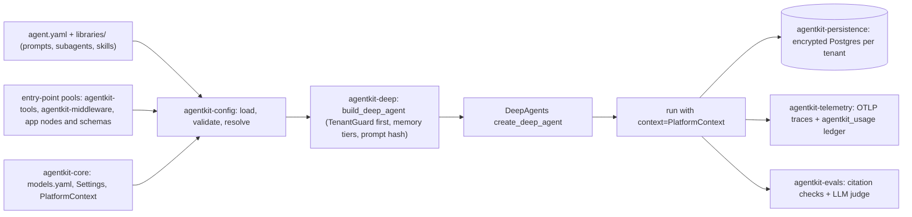

# agentkit

Shared, self-hosted, multi-tenant agent platform on DeepAgents / LangChain v1 / LangGraph.
Phase 0 is complete: a deep-research agent, defined in YAML and built through the `build_deep_agent`
factory, runs end to end on any registry model, with persisted threads, tenant-tagged traces and a usage
ledger. The full technical reference is [`docs/architecture.md`](docs/architecture.md).

## Architecture

agentkit is a thin policy layer over DeepAgents, not a fork. Teams describe an agent in `agent.yaml`,
picking a model, prompt, tools, skills, subagents and middleware by name from shared pools.
`agentkit-config` validates every name at load time and resolves the file into kwargs for
`build_deep_agent`, the one place that calls `create_deep_agent`. The factory always adds the
`PlatformContext` schema, puts `TenantGuardMiddleware` first, and wires encrypted Postgres persistence and
memory tiers when asked. Optional OpenAI Decisions selection picks the visible tools and the model tier
once per thread. Each tenant gets its own stamped deployment (database, AES key, collector, ports).



## Quickstart

```bash
cp .env.example .env        # fill in keys; .env is git-ignored, never commit it
make test                   # uv sync (pinned via constraints.txt) + offline tests
make lint                   # ruff, mypy, agentkit validate
```

Run the research agent (needs the chosen provider's key; web search uses DuckDuckGo and needs no key):

```bash
UV_CONSTRAINT=constraints.txt uv run research "your question"
UV_CONSTRAINT=constraints.txt uv run research-eval --judge anthropic
```

The agent is `apps/research_agent/agent.yaml`. `--model <registry entry>` switches provider (default
`fireworks-glm`, `accounts/fireworks/models/glm-5p3-flash`); `--tier` and `--no-selection` override the
other two keys; `--agent <file>` runs a different agent file. Keys come from the nearest `.env` (searched
upward from the current directory), and `.env` values win over shell exports. Both CLIs log progress to
stderr (resolved model, key names set, the Decisions selection, every delegation, search, fetch and file
write, run time); `-v` adds tool output and token counts, `-q` keeps warnings only. CLI and environment
reference: `docs/architecture.md` section 13.

## Test it manually

Run every command from the repo root: the CLIs read `.env` from the current directory, and `--dataset`
paths are relative to it. Every step except 1 costs real tokens.

### 1. Check the offline build

```bash
make test        # expect: 362 passed, 24 skipped (pg, no database), 7 deselected (live)
make lint        # expect: no ruff or mypy errors; agentkit validate: 0 error(s)
```

### 2. Check which keys you have

```bash
cp .env.example .env    # then fill in the keys you have
grep -oE '^[A-Z_]+=.' .env | cut -d= -f1    # lists the keys that are set, never their values
```

| What you run | Keys it needs |
|---|---|
| The shipped `apps/research_agent/agent.yaml` | `OPENAI_API_KEY` (it sets `selection: decisions`) and the provider's own key |
| Any run with `--no-selection` | The provider's own key |
| `research-eval` | The above, plus the key of the `--judge` entry (default `anthropic`) |

To try a provider without an OpenAI key, pass `--no-selection`: the agent sees every tool and stays on the
configured tier. For Tavily instead of DuckDuckGo, set `tools: [{web_search: {backend: tavily}}, fetch_url]`
and `TAVILY_API_KEY`; a subagent's `tools` replace the parent's, so set the backend on each subagent too.

### 3. Check that each model answers

```bash
uv run pytest -m live packages/agentkit-core/tests/test_live_providers.py -v
```

One short call per registry entry; an entry whose key is missing is skipped, not failed.

### 4. Run one research question

```bash
uv run research "When should a team choose RAG over fine-tuning?" \
	--model fireworks-glm --out report.md
```

A good run gives a structured report with inline citations, each a URL the agent fetched. Common failures:

- `ConfigError` naming a key means that key is missing from `.env`.
- A Decisions API error does not stop the run. The middleware logs `selection unavailable for thread ...`
  and falls back to all tools and the default tier.
- `agent finished without writing /report.md` means the model never wrote the report. Try another
  `--model`, and note the model in `docs/phase0-results.md`.

### 5. Score an agent with the eval

```bash
uv run research-eval --model fireworks-glm --judge anthropic \
	--out eval_results.md
```

Runs the 10 questions in `apps/research_agent/evals/smoke.jsonl` and scores citations, groundedness and
completeness into `eval_results.md` and `eval_results.json`. Use `--dataset` with a smaller JSONL file for
a cheaper run, and `--judge` with an entry you have a key for (e.g. `openai`).

### 6. Run the full live suite

```bash
RESEARCH_LIVE_MODELS=fireworks-glm \
	uv run pytest -m live -v
```

A model whose keys are missing is skipped. Record each result in `docs/phase0-results.md`.

## Layout

| Path | Purpose |
|---|---|
| `packages/agentkit-core` | `Settings`, model registry (`models.yaml`), `get_model`, `PlatformContext`, `BuildContext` |
| `packages/agentkit-config` | declarative layer: `load_agent`, pools, `Library`, validation, flows (`load_flow`), `agentkit validate` |
| `packages/agentkit-deep` | `build_deep_agent` factory, skills mount, memory tiers, scripted test models |
| `packages/agentkit-middleware` | `TenantGuardMiddleware`, per-thread `SelectionMiddleware` + Decisions client, retry and circuit breaker |
| `packages/agentkit-tools` | `web_search` (DuckDuckGo default, Tavily optional) and `fetch_url` tool factories |
| `packages/agentkit-persistence` | encrypted Postgres checkpoints and store (`open_persistence`), `thread_lock`, `agentkit-prune` |
| `packages/agentkit-telemetry` | tenant-tagged OTel tracing with masking, `run_config`, `CostLedger` (`agentkit_usage`) |
| `packages/agentkit-evals` | dataset, citation metrics, openevals LLM judge, runner |
| `apps/research_agent` | `agent.yaml`, `research` and `research-eval` CLIs, the `research_with_review` flow |
| `libraries/` | shared prompts and subagents (skills go in `libraries/skills/`) |
| `contracts/` | upstream contract suite (`-m contract`, `-m pg`) |
| `deploy/` | dev Postgres + collector (`compose.dev.yaml`), per-tenant stamp (`compose.yaml`, `tenants/`) |
| `scripts/` | tenant stamp and env helpers, Phase 0 exit check, offline `smoke.py` |

## Per-tenant deployments

Each tenant gets its own deployment: compose project `agentkit-<tenant>` with its own Postgres volume,
collector, ports, database password and AES key. Nothing is shared. Needs Docker.

```bash
make stamp TENANT=tenant-a        # writes deploy/tenants/tenant-a.env once (git-ignored), starts it, sets up the DB
scripts/tenant_env.sh tenant-a uv run research "your question" --tenant tenant-a --persist
make contract TENANT=tenant-a     # contract suite against the tenant's database
make phase0-exit                  # stamps tenant-a and tenant-b and proves they are separated
make unstamp TENANT=tenant-a      # stop it and delete its database (keeps the env file and key)
```

Langfuse forwarding and what stays plaintext at rest: `deploy/README.md` and `docs/architecture.md`
sections 9 to 11.

## Extending

Add tools and middleware as entry-point factories `(ctx: BuildContext, **params)`, prompts and subagents
as files under `libraries/`, models as entries in `models.yaml`, and agents and flows as YAML. Check YAML
with `uv run agentkit validate <files>`. Step-by-step recipes: `docs/architecture.md` section 15.

## Status

Phase 0 (T1-T9) and Phase 0b are delivered and live-verified (`docs/phase0-results.md`). All six model ids
answer a live call; live agent runs use only `fireworks-glm`, whose eval baseline is completed 1.00,
citation validity 0.96, completeness 0.97 and groundedness 0.64. A two-turn persisted `fireworks-glm` run
against a stamped tenant resumed its thread, traced it and metered both turns, and `make phase0-exit`
passes offline.

Open items: P10 thread-to-user binding, P3 primitive state stored in plaintext, AES key rotation and
backup, never-pruned store items of `eval-<hex>` users, and a prune tenant filter if tenants ever share a
database (`docs/architecture.md` section 16). Verify changes end to end with the `verify-agentkit` skill
(`.claude/skills/verify-agentkit/`). Next: Phase 1.

Design and plans: `docs/superpowers/specs/` and `docs/superpowers/plans/`; research and roadmap:
`reports/Reusable agent platform components.md`.
