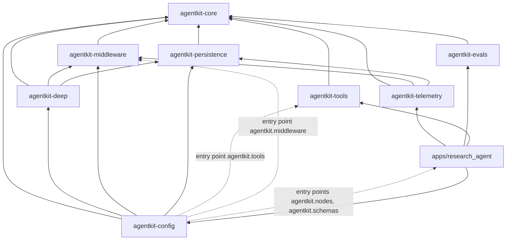
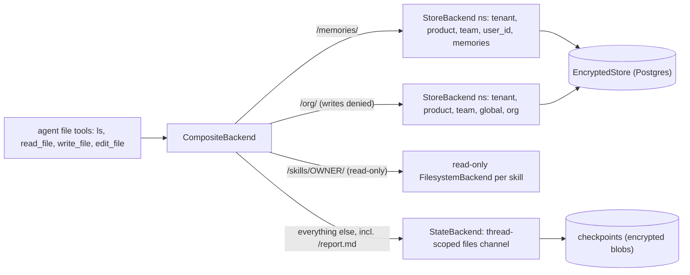
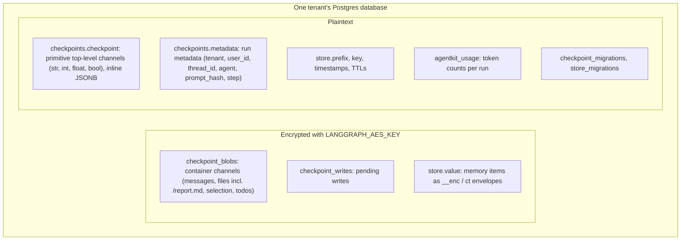
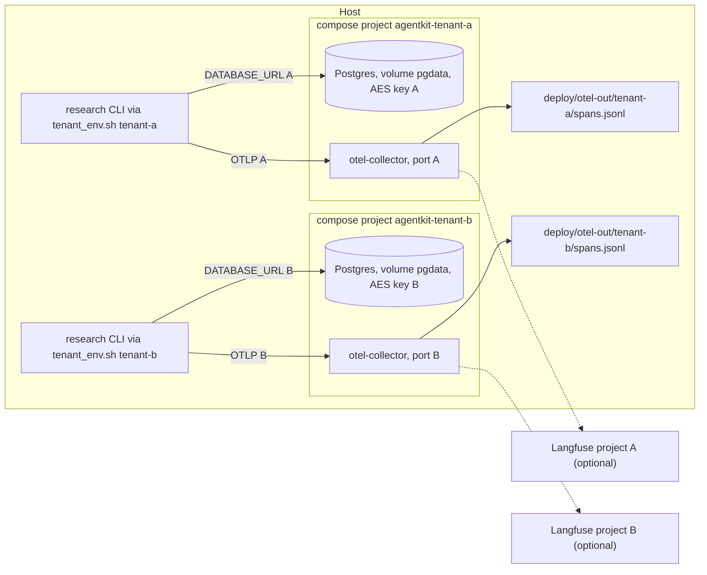
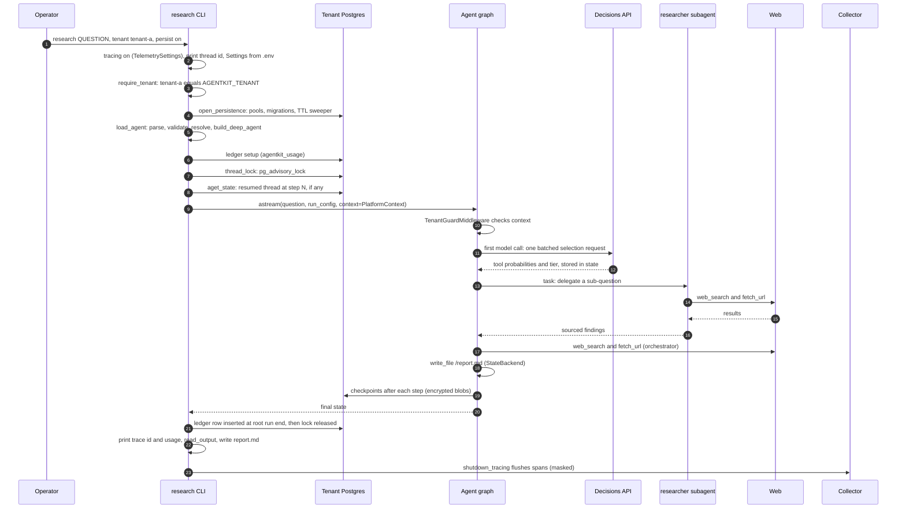

# agentkit architecture and technical reference

This document describes agentkit as it is built at the head of the repository. It is written for two
readers: an engineer joining the platform team, and a product team building an agent on the platform.
Every class, function, flag, environment variable and path named here exists in the code. Where the
design documents say one thing and the code does another, this document describes the code and calls
out the gap (search for **Gap**).

Contents

1. [Purpose and design principles](#1-purpose-and-design-principles)
2. [Package map](#2-package-map)
3. [The declarative layer](#3-the-declarative-layer)
4. [The factory: `build_deep_agent`](#4-the-factory-build_deep_agent)
5. [Models, providers and Decisions-based selection](#5-models-providers-and-decisions-based-selection)
6. [Tools](#6-tools)
7. [Skills mount and memory tiers](#7-skills-mount-and-memory-tiers)
8. [Tenancy and identity](#8-tenancy-and-identity)
9. [Persistence](#9-persistence)
10. [Telemetry and the cost ledger](#10-telemetry-and-the-cost-ledger)
11. [Deployment](#11-deployment)
12. [Testing strategy](#12-testing-strategy)
13. [Configuration and CLI reference](#13-configuration-and-cli-reference)
14. [How the research agent uses the framework](#14-how-the-research-agent-uses-the-framework)
15. [Extending the platform](#15-extending-the-platform)
16. [Security model, known limitations and open items](#16-security-model-known-limitations-and-open-items)
17. [Roadmap and further reading](#17-roadmap-and-further-reading)

---

## 1. Purpose and design principles

agentkit is a shared, self-hosted agent platform for organizations with many product teams, serving
several tenants. Teams build agents the same way on DeepAgents (`deepagents==0.7.32`), LangChain v1
(`langchain==1.4.7`) and LangGraph (`langgraph==1.2.19`), without a managed agent runtime.

Phase 0 is complete. A deep-research agent, built through the factory and defined in YAML, runs end to
end on any of six registry models, with OpenAI Decisions choosing its tools and tier. Its threads and
memory persist in encrypted Postgres, each run is traced to its tenant and metered, and each tenant
gets its own stamped deployment.

The design rests on these principles.

| Principle | What it means in the code |
|---|---|
| **A thin, opinionated policy layer over DeepAgents, not a fork** | `agentkit_deep.build_deep_agent` is the one place that calls `deepagents.create_deep_agent`. It adds policy (tenant guard, context schema, memory routes, permissions, prompt hash) through the SDK's own extension points: `context_schema`, the user-middleware slot, `CompositeBackend` routes and `FilesystemPermission`. No upstream code is patched or vendored. |
| **Declarative agents** | An agent is an `agent.yaml` that names a model, a prompt, tools, skills, subagents and middleware from shared pools (`agentkit-config`). Python is written only when a pool lacks a capability. |
| **Hard walls between tenants, soft walls within a tenant** | One deployment per tenant: its own Postgres, AES key, collector and ports (`deploy/compose.yaml`, `scripts/stamp_tenant.sh`). Inside a tenant, isolation is by store namespace `(tenant, product, team, user_id or "global", kind)`. `TenantGuardMiddleware` catches misrouted runs; it is a check, not the wall. |
| **Pinned versions and contract tests** | `constraints.txt` is the single source of version pins (applied through `UV_CONSTRAINT`). `contracts/` pins the observed behaviour of the upstream APIs the platform relies on, and a weekly canary runs it against the newest releases. |
| **Fail at load time** | Every name in a YAML file is checked before any network call or key lookup. All problems are reported together, each with file and YAML path (`SpecErrors`). Bad persistence or tenant configuration exits with one line and code 2 before the agent runs. |
| **Single responsibility** | Small modules (most under about 200 lines): `spec/` parses, `validate.py` checks, `resolve.py` turns a spec into factory kwargs, `load.py` wires them together. No class parses, resolves and builds. |

---

## 2. Package map

The repository is a uv workspace (`pyproject.toml`, members `packages/*` and `apps/*`), Python 3.12,
mypy strict, ruff with line length 100.

| Path | Responsibility | Key modules and APIs | Depends on (workspace) |
|---|---|---|---|
| `packages/agentkit-core` | Settings and secrets, the model registry, the run context | `Settings`, `ConfigError`, `Provider`, `ModelRegistry`, `ModelSpec`, `TIERS`, `get_model`, `PlatformContext`, `Label`, `check_label`, `check_user_id`, `store_namespace`, `BuildContext`; `models.yaml` | none |
| `packages/agentkit-tools` | Read-only research tools, their pool factories and tool governance | `web_search` and `fetch_url` factories (`factories.py`), `DuckDuckGoSearch`, `TavilySearch`, `HttpFetch`, `make_web_search_tool`, `make_fetch_tool`, `ToolError`; `platform_tool`, `ToolMeta`, `tool_meta`, `check_tool_contract`; `tool_schemas.json` | core |
| `packages/agentkit-connectors` | Connector specs, secret refs, embeddings, pooled engines and the curated KB tools | `load_connector`, `EnvSecrets`, `get_embeddings`, `get_engine`; `kb_search` and `sql_query` factories (`tools.py`); script `agentkit-kb` (`setup`, `ingest`) | core, tools |
| `packages/agentkit-middleware` | Tenant guard, Decisions-based selection, resilience | `TenantGuardMiddleware`, `TenantMismatch`, `MissingPlatformContext`, `SelectionMiddleware`, `Selector`, `Selection`, `ToolCard`, `DecisionsClient`, `DecisionsSelector`, `CircuitBreaker`, `call_with_retry`, `call_limit` factory | core |
| `packages/agentkit-persistence` | Encrypted Postgres checkpoints and store, thread locks, pruning | `PersistenceSettings`, `open_persistence`, `Persistence`, `EncryptedStore`, `StoreEncryptionError`, `thread_lock`, `prune`; script `agentkit-prune` | core |
| `packages/agentkit-deep` | The factory, skills mount, memory tiers, test doubles | `build_deep_agent`, `prompt_hash`, `agent_prompt_hash`; `memory.memory_backend`; `skills_mount.skills_mount`, `skills_routes`, `skills_source`; `testing.ScriptedChatModel`, `MeteredChatModel`, `ctx`, `memory_persistence` | core, middleware, persistence |
| `packages/agentkit-config` | The declarative layer: YAML specs, pools, validation, resolution, flows | `load_agent`, `LoadedAgent`, `Library`, `CodePools`, `SpecError`, `SpecErrors`, `read_output`; `flow.load_flow`, `flow.validate_flow`; script `agentkit` | core, deep, middleware, persistence (tools only as a dev dependency) |
| `packages/agentkit-telemetry` | Tenant-tagged tracing and the per-run usage ledger | `TelemetrySettings`, `configure_tracing`, `flush_tracing`, `shutdown_tracing`, `run_config`, `trace_id`, `CostLedger`, `UsageRow`, `setup`, `TENANT_ATTR` | core, middleware, persistence |
| `packages/agentkit-evals` | Eval runner on openevals, gates, single-step evals and the pytest plugin | `EvalCase`, `load_dataset`, `LLMJudge`, `Judge`, `citation_scores`, `extract_urls`, `run_eval`, `aggregate`, `to_markdown`, `RunResult`, `CaseResult`, `load_gates`, `check_gates`; `single_step`, `step_pass`, `tool_call_ratio`, `collect_run`; `pytest_plugin` (`agentkit_eval` marker) | core, config |
| `apps/research_agent` | The sample deep-research agent and its CLIs | `agent.yaml`, `flows/research_with_review.yaml`, `cli.py` (`research`), `eval_cli.py` (`research-eval`), `persist.py`, `telemetry.py`, `progress.py`, `flow_nodes.py`, `evals/smoke.jsonl` | all eight packages |
| `apps/kb_agent` | The pilot knowledge-base agent (YAML only, no Python package) | `agent.yaml`, `evals/golden.jsonl`, `evals/gates.yaml`, `evals/baseline.json` | connectors (through the tool pool) |
| `libraries/` | Shared file-based pools | `prompts/<name>/v<x.y.z>.md` (research orchestrator and researcher, kb answerer), `prompts/labels.yaml`, `connectors/kb-docs.yaml`, `connectors/kb-sql.yaml`, `subagents/researcher.yaml` (no skills ship yet) | n/a |
| `contracts/` | Upstream contract suite | `test_deepagents_contract.py`, `test_langchain_contract.py`, `test_langgraph_contract.py`, `test_postgres_contract.py` | n/a |
| `deploy/` | Dev stack and per-tenant stamp | `compose.dev.yaml`, `compose.yaml`, `otel-collector.dev.yaml`, `otel-collector.yaml`, `tenants/example.env`, `README.md` | n/a |
| `scripts/` | Operations and smoke runs | `stamp_tenant.sh`, `tenant_env.sh`, `tenant_setup.py`, `phase0_exit.sh`, `smoke.py` | n/a |

### Dependency direction

Arrows point from a package to what it depends on. Dotted arrows are runtime discovery through Python
entry points, not imports: `agentkit-config` never imports `agentkit-tools` or the middleware
factories by name, and neither of them depends on `agentkit-config`.



`agentkit-telemetry` depends on `agentkit-middleware` only for the `DECISIONS_USAGE_EVENT` name, and on
`agentkit-persistence` only to write ledger rows through `Persistence.pool`.

Registered entry points at HEAD:

| Group | Name | Target | Declared in |
|---|---|---|---|
| `agentkit.tools` | `web_search` | `agentkit_tools.factories:web_search` | `packages/agentkit-tools/pyproject.toml` |
| `agentkit.tools` | `fetch_url` | `agentkit_tools.factories:fetch_url` | `packages/agentkit-tools/pyproject.toml` |
| `agentkit.middleware` | `call_limit` | `agentkit_middleware.factories:call_limit` | `packages/agentkit-middleware/pyproject.toml` |
| `agentkit.schemas` | `research.ReviewState` | `research_agent.flow_nodes:ReviewState` | `apps/research_agent/pyproject.toml` |
| `agentkit.nodes` | `research.critique` | `research_agent.flow_nodes:critique` | `apps/research_agent/pyproject.toml` |
| `agentkit.nodes` | `research.needs_rework` | `research_agent.flow_nodes:needs_rework` | `apps/research_agent/pyproject.toml` |

Console scripts: `agentkit` (`agentkit_config.cli:main`), `agentkit-prune`
(`agentkit_persistence.prune:main`), `research` (`research_agent.cli:main`), `research-eval`
(`research_agent.eval_cli:main`).

---

## 3. The declarative layer

`agentkit-config` turns YAML into a compiled graph. Three kinds of file exist, all with
`apiVersion: agentkit/v1`: `kind: Agent`, `kind: SubAgent` and `kind: Flow`. Specs are pydantic models
with `extra="forbid"`, so an unknown key is a load error. `spec/` imports no LangChain code.

### 3.1 `agent.yaml`

The shipped research agent, `apps/research_agent/agent.yaml`:

```yaml
apiVersion: agentkit/v1
kind: Agent
name: research_agent
model: fireworks-glm
tier: default
selection: decisions
prompt: research/orchestrator
tools: [web_search, fetch_url]
subagents: [researcher]
output: /report.md
middleware:
  - {type: model_fallback, params: {models: ["fireworks-glm:strong"]}}
  - {type: model_retry, params: {max_retries: 2}}
  - {type: call_limit, params: {max_model_calls: 60}}
  # Budget the research tools, not every tool: a run that spends it must still write /report.md.
  - {type: tool_call_limit, params: {tool_name: web_search, run_limit: 20}}
  - {type: tool_call_limit, params: {tool_name: fetch_url, run_limit: 25}}
  - {type: pii, params: {type: email}}
  - {type: pii, params: {type: credit_card, strategy: mask}}
  - {type: require_output, params: {path: /report.md}}
```

The `middleware` list is the Phase 1 standard stack, applied in the canonical order (section 4)
whatever the file order: a failing primary model falls back to `fireworks-glm:strong`
(`accounts/fireworks/models/glm-5p3`), each model is retried twice, a run stops after 60 model calls
and the orchestrator may call `web_search` 20 times and `fetch_url` 25 times per run (further calls get an
error tool message telling the model to stop; `write_file` is never budgeted, so the report can always be
saved; a single all-tools `run_limit: 40` blocked the final `write_file` and left two golden cases with an
empty report), e-mail addresses and card numbers are redacted or masked, and `require_output` sends
the run back to the model (a user nudge, at most twice per run, logged as `/report.md missing after a
final reply; nudging (n/2)`) when the model replies without a tool call before `/report.md` is written
in this run (a report left by an earlier turn of a resumed thread does not count; a run resumed from an
interrupt accepts any existing report):
live `fireworks-glm` runs sometimes ended on "Let me delegate ..." with no tool call. Fallback models are
built when the agent loads, so the shipped agent needs `FIREWORKS_API_KEY` for every `--model`, not only
for `fireworks-*` entries; an agent file without the `model_fallback` entry does not.

`AgentSpec` fields (`spec/agent.py`):

| Field | Type, default | Meaning |
|---|---|---|
| `apiVersion` | `"agentkit/v1"` (required) | Format version |
| `kind` | `"Agent"` (required) | |
| `name` | str (required) | Agent name; becomes `PlatformContext.agent_name`, so in practice it must be a valid label (see 8.1) |
| `description` | str, `""` | |
| `version` | str, `"0.1.0"` | Becomes `PlatformContext.agent_version` |
| `tags` | list of str, `[]` | |
| `model` | str (required) | Entry name in `models.yaml` |
| `tier` | str, `"default"` | `fast`, `default` or `strong` |
| `selection` | `decisions` or null | Decisions picks the visible tools and the tier (section 5.3) |
| `prompt` | str (required) | Prompt pool name, e.g. `research/orchestrator` |
| `tools` | list of tool refs, `[]` | `web_search`, or `{fetch_url: {max_chars: 20000}}`, or `{name: ..., params: {...}}` |
| `skills` | list of str, `[]` | Skill pool names |
| `subagents` | list, `[]` | Each entry is a subagent pool name or an inline `SubAgentSpec` |
| `middleware` | list of `{type, params, enabled}`, `[]` | Middleware pool entries; `enabled: false` skips one |
| `output` | str or null | Absolute path of the file that holds the agent's answer (e.g. `/report.md`); null means the last AI message |

A larger illustrative example (from the declarative design spec; `critic`, `citations` and the
`research/critic` prompt do not ship):

```yaml
apiVersion: agentkit/v1
kind: Agent
name: research_agent
model: fireworks-glm
tier: default
selection: decisions
prompt: research/orchestrator
tools:
  - web_search
  - fetch_url: {max_chars: 20000}
skills: [citations]
subagents:
  - researcher                 # from libraries/subagents/researcher.yaml
  - name: critic               # inline, same shape as a subagent file
    description: Checks a draft report for unsupported claims.
    prompt: research/critic
    tools: [fetch_url]
middleware:
  - type: call_limit
    params: {max_model_calls: 40}
output: /report.md
```

### 3.2 `SubAgent` files

`libraries/subagents/researcher.yaml`:

```yaml
apiVersion: agentkit/v1
kind: SubAgent
name: researcher
description: Read-only researcher for one sub-question; returns sourced findings.
prompt: research/researcher
tools: [web_search, fetch_url]
```

`SubAgentSpec` fields: `name`, `description`, `prompt` (required); `tools`, `skills`, `middleware`
(default empty); `model`, `tier`, `response_schema` (optional). DeepAgents semantics apply: a
subagent's `tools` **replace** the parent's, and its `skills` are not inherited. An unset `model` or
`tier` is inherited from the parent spec; when neither is set, no model is passed for the subagent
and DeepAgents uses the parent's model object. `response_schema` names an entry in the `schemas`
code pool and is passed through as the subagent's `response_format`.

### 3.3 Pools and the `Library`

Pools resolve names to objects. File pools come from library roots; code pools come from entry
points.

| Pool | Source | Name | Value |
|---|---|---|---|
| prompts | `<root>/prompts/**/*.md` | path under `prompts/` without `.md`, e.g. `research/orchestrator` | `Prompt` (text with optional `---` front matter stripped) |
| skills | `<root>/skills/*/SKILL.md` | directory name, which must equal the front matter `name` | `Skill(name, dir, tools)`; `tools` from `metadata.include_tools` and `allowed-tools` |
| subagents | `<root>/subagents/*.yaml` | the file's `name` | `SubAgentSpec` |
| agents | `<root>/agents/*.yaml` and `<root>/agent.yaml` | the file's `name` | path to the file (used by flow agent nodes) |
| tools | entry point group `agentkit.tools` | entry point name | factory `(ctx: BuildContext, **params) -> BaseTool` |
| middleware | entry point group `agentkit.middleware` | entry point name | factory `(ctx: BuildContext, **params) -> AgentMiddleware` |
| nodes | entry point group `agentkit.nodes` | entry point name | flow node or router callable |
| schemas | entry point group `agentkit.schemas` | entry point name | a type (flow state schema or subagent response schema) |
| models | `agentkit_core/models.yaml` | entry name | see section 5 |

`Library.for_file(path, code)` picks the roots for one YAML file, in order: the file's own directory,
the nearest ancestor directory named `libraries/`, then each directory in `AGENTKIT_LIBRARY_PATH`
(`os.pathsep`-separated). Roots that do not exist are dropped. A name defined in two roots is an
error (`duplicate prompt 'x': defined in both ... and ...`): there is no shadowing or layering yet.
`CodePools.from_entry_points()` loads the four code pools, and `CodePools.override(tools={...})`
replaces entries (tests use it to swap in fake search and fetch).

**Gap.** The research report describes layered pools (org, then tenant, then product, then team, with
the last source winning) and tenant filtering of tool registries. The design spec deferred both, and
the code has neither: duplicate names fail the load.

Prompts can use exactly two variables, `{{agent_name}}` and `{{date}}` (ISO date at build time); any
other `{{var}}` is a validation error.

### 3.4 Validation rules

`validate_agent`, `validate_subagent` and `validate_flow` never raise; they return every
`SpecError(file, path, message, severity)` they find. `load_agent` logs warnings and raises
`SpecErrors` if any error remains. Paths use YAML notation such as `subagents[0].tools[1]`.

Checked at load time, before any key lookup or network call:

- Unknown keys anywhere, a wrong `kind` or `apiVersion`, YAML syntax errors, empty files, non-UTF-8
  files.
- Unknown model entry or tier (errors list the known names).
- Unknown prompt, or a prompt using a variable other than `agent_name` and `date`.
- Unknown tool, a duplicate tool in one list, or params the factory signature does not accept
  (checked with `inspect.signature(factory).bind(None, **params)`).
- Unknown skill, or a skill whose `SKILL.md` names tools that the owning agent or subagent lacks.
  DeepAgents built-in tools (`BUILTIN_TOOLS`) always count as owned.
- Unknown middleware type or bad params. `type: selection` is rejected with `use top-level 'selection:'`,
  because the platform owns where selection sits in the middleware order.
- Unknown subagent, a duplicate subagent, or a subagent named like its parent.
- Unknown `response_schema`. A subagent with no `response_schema` gets the **warning**
  `no response_schema; completion contract recommended` (the shipped `researcher` triggers it).
- `output` that is not an absolute path.

Missing API keys are not validation errors, so `agentkit validate` runs in CI without secrets. They
fail later, at build, with `ConfigError` naming the variable.

`make lint` runs:

```bash
uv run agentkit validate apps/*/agent.yaml apps/*/flows/*.yaml libraries/subagents/*.yaml
```

It prints each problem, then `checked N file(s): E error(s), W warning(s)`, and exits 1 on any error.

### 3.5 Load pipeline and overrides

```mermaid
flowchart LR
  yaml["agent.yaml"] --> parse["parse_agent (pydantic, extra=forbid)"]
  parse --> ovr["apply_overrides (model, tier, selection)"]
  ovr --> val["validate_agent against Library and ModelRegistry"]
  val -->|"errors"| fail["raise SpecErrors (all problems, file and YAML path)"]
  val -->|"ok"| res["resolve_agent: render prompts, call tool and middleware factories, build subagent dicts, skills routes, SelectionMiddleware"]
  res --> build["build_deep_agent(**kwargs)"]
  build --> cda["deepagents.create_deep_agent"]
  cda --> graph["compiled graph with config metadata prompt_hash"]
```

```python
load_agent(path, *, settings, library=None, overrides=None, model=None, persistence=None) -> LoadedAgent
```

`LoadedAgent` holds `graph`, `spec` (the `AgentSpec` after overrides) and `model_spec` (the resolved
`ModelSpec`). `overrides` accepts only the keys `model`, `tier` and `selection`; `selection: "off"`
turns selection off. The CLI flags map onto it:

| CLI flag | Override |
|---|---|
| `--model <entry>` | `{"model": entry}` |
| `--tier <tier>` | `{"tier": tier}` |
| `--no-selection` | `{"selection": "off"}` |

Overrides apply to the top-level agent only. A subagent with its own `model` or `tier` keeps it.

`model=` (a `BaseChatModel` instance) is a test seam: it replaces the registry model and turns off
per-tier model switching in selection.

### 3.6 Flows

A flow is a LangGraph `StateGraph` described in YAML. The shipped example is
`apps/research_agent/flows/research_with_review.yaml`:

```yaml
apiVersion: agentkit/v1
kind: Flow
name: research_with_review
description: Research a question, critique the draft (up to two reworks), then pause for human review.
state: research.ReviewState            # state-schema pool
nodes:
  research: {agent: research_agent, input: [question, critique], output: draft}   # agent node
  critique: {fn: research.critique}                                                # function node
  review:   {interrupt: true}                                                      # human-in-the-loop pause
edges:
  - START -> research -> critique
  - from: critique
    route: research.needs_rework       # router pool fn: state -> key
    to: {rework: research, ok: review}
  - review -> END
```

| Element | Shape | Behaviour |
|---|---|---|
| `state` | schema pool name | The `StateGraph` state type (here the `ReviewState` TypedDict) |
| Agent node | `{agent, input, output}` | Runs the named agent (agents pool) via `load_agent`. `input` is one state field, or a list of fields joined as `## field` sections (empty fields skipped). The answer (`read_output`: the agent's `output` file, else the last AI message) is written to the `output` field. The flow's `PlatformContext` is forwarded to the agent run. |
| Function node | `{fn}` | A nodes-pool callable, `state -> partial state` |
| Interrupt node | `{interrupt: true}` | Calls LangGraph `interrupt({"node": name})`; the resume value must be a non-empty mapping, merged into state |
| Plain edge | string `"A -> B -> C"` | Chains expand into pairwise edges; `START` and `END` are the graph endpoints |
| Route | `{from, route, to}` | `route` is a nodes-pool router returning a key of `to`; compiles to `add_conditional_edges` |

`validate_flow` checks the state schema, every node reference (and each referenced agent file's own
errors, reported once per file), edge sources and targets, router names, that some edge leaves
`START`, that every node is reachable from `START`, and that `END` is reachable from every node.

```python
load_flow(path, *, settings, library=None, model=None, checkpointer=None) -> CompiledStateGraph
```

`load_flow` validates the whole flow before building anything, refuses interrupt nodes without a
`checkpointer`, and compiles with `context_schema=PlatformContext`. Its roots
(`flow_roots`) are the flow's directory, its parent (the app directory holding `agent.yaml`), then the
usual library roots. Invoke it with `context=PlatformContext(...)`; resume an interrupt with
`Command(resume={...})`.

**Gap.** There is no CLI for flows; `research_with_review` is exercised by
`apps/research_agent/tests/test_review_flow.py` only. `load_flow` takes a `checkpointer` but no
`Persistence`, so agent nodes in a flow do not get memory tiers.

### 3.7 The prompt registry

Prompts live under the library roots' `prompts/` directory (`libraries/prompts/` for the shipped
agents), owned by `agentkit_config.pools.prompts.PromptRegistry`.

- **Layout.** A versioned prompt is a directory of files `prompts/<name>/v<MAJOR.MINOR.PATCH>.md`, each
  with front matter (`owner`, `description`, optional `eval_suite`). A flat `prompts/<name>.md` is an
  unversioned prompt with version `0.0.0`. One name cannot have both forms.
- **References** (the `prompt:` field of an agent or subagent): `name` (highest version), `name@1`
  (highest `1.x.y`), `name@1.2.0` (exact), `name@<label>` (from `prompts/labels.yaml`, for example
  `research/orchestrator: {production: 1.0.0}`). An unknown version or label is a `SpecError` that
  lists the versions that exist. A bare name such as `prompt: research/orchestrator` keeps working.
- **Fragments.** `{{> other/name}}` includes another prompt (its highest version), at most 5 levels deep
  (`MAX_FRAGMENT_DEPTH`). A cycle, a missing fragment or a deeper chain is a `SpecError` at validate time,
  never a `RecursionError` at run time.
- **Variables.** Only `{{agent_name}}` and `{{date}}` are substituted (no Jinja), as before.
- **Prompt id.** The resolved prompt's `name@version` travels from `build_deep_agent` to
  `run_config(prompt_id=...)`, so traces and checkpoint metadata record which prompt version ran next to
  the prompt hash.

The shipped prompts are `research/orchestrator`, `research/researcher` and `kb/answerer`, each at
`v1.0.0` with a `production` label. Langfuse prompt sync is a Phase 2 item.

---

## 4. The factory: `build_deep_agent`

```python
build_deep_agent(
    *, model, system_prompt, tools=(), subagents=(), middleware=(), settings=None,
    checkpointer=None, name=None, skills=None, backend=None, permissions=None,
    store=None, persistence=None,
) -> compiled graph
```

`build_deep_agent` (`packages/agentkit-deep/src/agentkit_deep/factory.py`) is the only caller of
`create_deep_agent`. Whatever the caller passes, it always does the following.

| Enforced | How |
|---|---|
| A concrete model | `model` is a `BaseChatModel` or a `ModelSpec`; a `ModelSpec` needs `settings` and is built with `get_model`, which fails fast if the provider key is missing. |
| `context_schema=PlatformContext` | Every run must pass `context=PlatformContext(...)` (a dict is validated against it). |
| `TenantGuardMiddleware` first | The guard for the deployment tenant (`settings.deployment_tenant`, or `AGENTKIT_TENANT` read once per process when no settings are given) is prepended to the caller's middleware. Passing a `TenantGuardMiddleware` yourself raises `ValueError`. |
| Caller middleware order preserved | The middleware list is `[guard, *middleware]`. From YAML, `middleware` is sorted into the canonical order (`agentkit_config/stack.py`, `STACK_ORDER`): `selection` (when `selection: decisions`), `model_fallback`, `model_retry`, `tool_retry`, `require_output`, `call_limit`, `tool_call_limit`, `pii`, then any other pool entries in file order. File order no longer matters. The first entry is the outermost wrapper: `SelectionMiddleware` overrides the request's model, so fallback sits inside it and can swap the model on failure, and retry sits inside fallback so each model is retried before the next is tried. `require_output` sits outside `call_limit`, so the model calls its nudges cause are counted against the budget. Validation rejects a second enabled `selection`, `model_fallback`, `model_retry`, `tool_retry`, `require_output` or `call_limit`, and repeats of `pii` (same `type`) or `tool_call_limit` (same `tool_name`); an agent without an enabled `call_limit` gets a warning. DeepAgents then wraps its own stack around this user-middleware slot. |
| Skills | `skills` are skill *sources* (`skills_source(owner)`), passed through with `backend` and `permissions` (section 7). |
| Persistence | With `persistence`: its encrypted `saver` and `store` become the checkpointer and store (passing `checkpointer` or `store` too raises `ValueError`); the backend becomes `memory_backend()` unless the caller passed one built by `memory_backend(...)` (any other backend raises `ValueError`); `memory=["/org/AGENTS.md", "/memories/AGENTS.md"]`; and `ORG_WRITE_DENY` is prepended to the permissions. |
| Prompt hash | The returned graph is `agent.with_config(metadata={"prompt_hash": prompt_hash(system_prompt)})`, so every run and trace inherits it. |

`prompt_hash(system_prompt)` is the SHA-256 hex of the prompt text as configured. It does not cover
DeepAgents' base prompt or the `AGENTS.md` memory added at run time. `agent_prompt_hash(graph)` reads
it back (`""` for a graph not built by the factory).

**Gap.** The research report's factory sketch has a fixed, canonical platform middleware list (tenant
guard, identity and tool policy, tool surface, model fallback and retry, tool error handling and
retry, call limits, PII, todo list) and an org-to-tenant-to-role prompt composer. The code enforces
the guard's position, and YAML agents get the resilience and limit middleware (fallback, retry, call
limits, PII) in the canonical order; identity and tool policy, tool error handling, the todo list and
the prompt composer are not there yet. The factory
also does not disable DeepAgents' automatically added `general-purpose` subagent, which the report
recommends turning off by default.

---

## 5. Models, providers and Decisions-based selection

### 5.1 The registry

`packages/agentkit-core/src/agentkit_core/models.yaml` maps logical entries to provider model ids per
tier. It ships as package data and `ModelRegistry.default()` always reads it.

```yaml
default_provider: anthropic
models:
  openai:
    fast: gpt-6-luna
    default: gpt-6-luna
    strong: gpt-6-luna
  # google_genai: gemini-3.8-flash on every tier
  anthropic:
    fast: claude-haiku-5-5
    default: claude-haiku-5-5
    strong: claude-opus-5-5
  fireworks-glm:
    provider: fireworks
    fast: accounts/fireworks/models/glm-5p3-flash
    default: accounts/fireworks/models/glm-5p3-flash
    strong: accounts/fireworks/models/glm-5p3
  # fireworks-minimax: strong is minimax-m3; fireworks-deepseek: same model on every tier
```

| Entry | Provider | Model id (fast, default) | Key |
|---|---|---|---|
| `openai` | `openai` | `gpt-6-luna` | `OPENAI_API_KEY` |
| `google_genai` | `google_genai` | `gemini-3.8-flash` | `GOOGLE_API_KEY` |
| `anthropic` | `anthropic` | `claude-haiku-5-5` | `ANTHROPIC_API_KEY` |
| `fireworks-deepseek` | `fireworks` | `accounts/fireworks/models/deepseek-v4p1-flash-1017` | `FIREWORKS_API_KEY` |
| `fireworks-glm` | `fireworks` | `accounts/fireworks/models/glm-5p3-flash` | `FIREWORKS_API_KEY` |
| `fireworks-minimax` | `fireworks` | `accounts/fireworks/models/minimax-m3p1-flash` | `FIREWORKS_API_KEY` |

`ModelRegistry.resolve(name, tier)` returns `ModelSpec(provider, model_id, kwargs)`. The provider is the
entry's `provider` key, else the entry name; it must be a `Provider` value (`openai`, `google_genai`,
`anthropic`, `fireworks`). An optional `kwargs:` mapping is passed to the model constructor.
`get_model(spec, settings)` calls `langchain.chat_models.init_chat_model(model_id,
model_provider=..., api_key=..., **kwargs)`.

Switching provider is a config change: `--model <entry>` on the CLIs, or `model:` in the YAML. Tiers are
`fast`, `default` and `strong` (`TIERS`). `fast` and `default` stay on the cheap model (an
operator decision to keep costs down). `strong` is a bigger model for `anthropic` (`claude-opus-5-5`),
`fireworks-glm` (`glm-5p3`) and `fireworks-minimax` (`minimax-m3`). `openai`, `google_genai` and
`fireworks-deepseek` have no strong model chosen yet, so tier switching changes nothing on those entries.

### 5.2 How selection is wired

`selection: decisions` makes `resolve_agent` append the middleware built by
`agentkit_config.selection.decisions_middleware`:

```python
selector = DecisionsSelector(
    DecisionsClient(ctx.settings.require_key(Provider.OPENAI)),
    default_tier=tier,
    system_prompt=system_prompt,
)
models = {t: get_model(registry.resolve(entry, t), ctx.settings) for t in TIERS}  # unless a model instance was passed
SelectionMiddleware(selector, models=models, default_tier=tier)
```

So a Decisions agent needs `OPENAI_API_KEY` even when it runs on another provider. `--no-selection`
removes the need.

### 5.3 `SelectionMiddleware`

`SelectionMiddleware` (`agentkit_middleware/selection.py`) wraps every model call
(`awrap_model_call`):

1. If the agent state already holds `agentkit_selection` (a private state key, `{"tier", "tools"}`),
   it reuses it. Otherwise it calls the selector once, with the first human message as the task, the
   non-built-in tools as `ToolCard(name, description)`, and the run's `PlatformContext.thread_id`.
2. It offers the model only the selected tools plus every DeepAgents built-in (`BUILTIN_TOOLS`: `ls`,
   `read_file`, `write_file`, `edit_file`, `delete`, `glob`, `grep`, `execute`, `task`,
   `write_todos`). Built-ins are never hidden.
3. If the selected tier has a model in `models`, the request is overridden to use it.
4. On the first call it stores the selection in state with a `Command(update=...)`, so the selection is
   made **once per thread**. With a checkpointer it survives restarts and later turns (the Phase 0b
   close-out's second turn made no Decisions call). Two threads in one process select independently.
5. If the selector reports usage, it dispatches a custom callback event
   `agentkit.decisions_usage` (`DECISIONS_USAGE_EVENT`), which the cost ledger records.

The state key is private, so a subagent neither inherits nor overwrites its parent's selection. A
declarative subagent cannot add selection (the validator rejects `type: selection`), so the shipped
`researcher` always sees both of its tools and runs on the parent's configured model.

**Failure mode.** Any exception from the selector (API error, timeout, open breaker) logs
`selection unavailable for thread <id> (<error>); using all tools`, and the fallback (all tools,
default tier) is stored like a real selection, so a failing API is not called again on that thread.
The run continues.

### 5.4 `DecisionsSelector` and `DecisionsClient`

`DecisionsSelector.select` sends **one** request per thread to `POST https://api.openai.com/v1/decisions`
with model `gpt-6-luna` (`docs/reference/openai-decisions-api.md`):

- `input`: `<system>` (the agent's rendered prompt), `<tool_catalog>` (every tool's name and
  description), then `<request>` (the task). Stable content goes first so the prefix is cacheable.
- `questions`: one `predicate` per tool, `tool:<name>` ("Will the agent likely need the tool ..."),
  up to 399, plus one `choice` question `model_tier` over the tier descriptions (`DEFAULT_TIERS`).
- `prompt_cache_key`: the thread id.

A tool is kept when its probability is at least `threshold` (0.5). A missing or refused answer keeps
the tool. `max_tools` (default none) caps the kept set by probability, and `always_include` tools are
always kept. The tier answer is used only when it is a known tier with `confidence` of at least
`confidence_floor` (0.5); otherwise the default tier stays.

`DecisionsClient.decide` retries 429, 5xx and transport errors with full-jitter exponential backoff
(`backoff_delay`: uniform(0, min(cap, base * 2^attempt)); 3 attempts, base 0.5 s, cap 8 s, 15 s
timeout). Other 4xx responses raise `DecisionsError` without retry. Every attempt goes through a
`CircuitBreaker` (opens after 5 failures, half-opens after 30 s and lets one probe through). An open
breaker or exhausted retries raise `Unavailable`.

Unless a breaker is passed in, every `DecisionsClient` uses the process-wide breaker for its endpoint
(`shared_breaker("decisions:<url>")`). A new client is built for every `load_agent` call
(`research-eval` builds one per case), so the breaker's state lasts for the whole process rather than one
run. Tests reset it with `reset_shared_breakers()` (an autouse fixture in the root `conftest.py`).

**Risk: vague prompts hide every tool.** Two real responses are recorded as fixtures
(`packages/agentkit-middleware/tests/fixtures/decisions_live_orchestrator.json`,
`decisions_live_short_prompt.json`). With the real orchestrator prompt, `web_search` and `fetch_url`
scored 1.00; with the one-line prompt "You are a deep-research agent." they scored 0.03 and 0.01, so
the agent would have lost search entirely. Agents with `selection: decisions` need a prompt that says
which tools to use and when. A minimum-tools guard is not implemented (candidate for Phase 3).

---

## 6. Tools

The two web tools below and the two knowledge-base tools (section 6.2) are read-only. Errors are
returned to the model as text starting with `ERROR:`, so the agent can recover instead of crashing.

| Tool | Factory | Params | Behaviour |
|---|---|---|---|
| `web_search(query, k=5)` | `agentkit_tools.factories.web_search` | `backend`: `duckduckgo` (default) or `tavily` | Numbered results with title, URL and snippet. DuckDuckGo uses the `ddgs` package and needs no key. `backend: tavily` needs `TAVILY_API_KEY` (missing key: `ConfigError` at build). |
| `fetch_url(url)` | `agentkit_tools.factories.fetch_url` | `max_chars` (default 20000) | Fetches a page with `httpx` (20 s timeout, follows up to 5 redirects), reads at most 1,000,000 bytes, strips HTML to text (skipping `script`, `style`, `noscript`, `svg`, `head`), truncates to `max_chars` and appends `[truncated]`. |

`fetch_url` refuses non-`http(s)` URLs, `localhost`, hosts ending in `.internal`, and IP literals that are
not globally routable. Redirects are followed by hand and every hop is re-checked
against these rules, so a public URL cannot redirect to a private address. DNS rebinding is out of scope
(see section 16).

To use Tavily:

```yaml
tools: [{web_search: {backend: tavily}}, fetch_url]
```

Subagent tools replace the parent's, so set the backend on each subagent too.

### Adding a tool

1. Write a factory that takes the build context and keyword params and returns a LangChain tool:

   ```python
   from agentkit_core import BuildContext
   from langchain_core.tools import BaseTool

   def my_tool(ctx: BuildContext, *, limit: int = 10) -> BaseTool:
       ...  # read keys from ctx.settings, never from os.environ
   ```

   `BuildContext` carries `settings`, the resolved `model` (`ModelSpec`), `agent_name`, and
   `platform` (always `None` today; reserved).
   Decorate it with `@platform_tool(owner=..., version="1.0.0", side_effects="read")` (section 6.1)
   and run `make tool-schemas` to record its argument schema; a factory without metadata loads with a
   warning.
2. Register it in your package's `pyproject.toml`:

   ```toml
   [project.entry-points."agentkit.tools"]
   my_tool = "my_pkg.factories:my_tool"
   ```

3. Name it in YAML: `tools: [my_tool]` or `tools: [{my_tool: {limit: 5}}]`. Params are checked against
   the factory signature at load time.

### 6.1 Tool governance: `@platform_tool` and tenant policy

Every pool tool factory carries governance metadata, attached with
`agentkit_tools.platform_tool(...)` (a `ToolMeta`):

| Field | Meaning |
|---|---|
| `owner` | owning team |
| `version` | `MAJOR.MINOR.PATCH`; the major version must change when the tool's argument schema changes |
| `tenants` | tenants allowed to use the tool; `None` (the default) means every tenant |
| `side_effects` | `read`, `write` or `external` |
| `identity` | `service` (default) or `user` |
| `classification` | `public`, `internal` (default) or `confidential` |
| `examples` | optional example calls |

The decorator goes on the *factory*, not the built tool, so `agentkit validate` can check policy without
building tools or needing keys. `resolve` copies the metadata onto `tool.metadata["agentkit"]` at build.
`check_tool_contract(tool)` lists what a built tool lacks (a description, typed arguments, no runtime
identity arguments such as `tenant` or `user_id`).

- **Tenant policy.** An agent or subagent that names a tool whose `tenants` excludes the deployment
  tenant (`AGENTKIT_TENANT`, default `default`) fails `agentkit validate` and `load_agent` with a
  `SpecError` at `tools[N]` naming the tool and the tenant, before any key check. Policy is checked at
  build and validate time, not per call: one deployment serves one tenant and `TenantGuardMiddleware`
  rejects every other tenant's run. A factory without metadata loads with a warning.
- **Recorded, not enforced yet.** `side_effects`, `identity` and `classification` are listed but not
  enforced; no shipped tool writes. HITL for `side_effects: write` is a Phase 2 item.
- **`agentkit tools list [--tenant T]`** prints one line per tool the tenant may use:
  `name version side_effects classification owner tenants` (`*` = every tenant).
- **`agentkit tools snapshot [--check] [--file PATH]`** (`make tool-schemas`) writes or checks
  `packages/agentkit-tools/tool_schemas.json`, `{name: {version, schema}}`. A test fails when a tool's
  argument schema changes without a major version bump.

The shipped tools:

```text
$ uv run --no-sync agentkit tools list
fetch_url 1.0.0 external public platform *
kb_search 1.0.0 read internal platform *
sql_query 1.0.0 read confidential platform *
web_search 1.0.0 external public platform *
```

`web_search` and `fetch_url` have pydantic argument schemas (`query`, `k` 1-10, default 5; `url`) and
descriptions that say when to use the tool and when not to.

### 6.2 Connectors and the curated knowledge-base tools

`packages/agentkit-connectors` owns data-source access. Agents never get a raw SQL toolkit or a
connection; they reach Postgres only through two curated tools.

- **Connector specs** are YAML files `libraries/connectors/<name>.yaml`, a union on `kind`:
  `pgvector` (`dsn`, `collection`, `embeddings`) and `postgres` (`dsn`, `schemas`, plus limits such as
  `max_rows` and the statement timeout). `load_connector` takes the first match over the library roots;
  an unknown name is a `ConfigError` that lists the known ones.
- **Secrets.** `dsn` is a secret reference. Only `env://VAR` is implemented (`EnvSecrets`, behind a
  `SecretsProvider` protocol so Vault or a cloud secret manager can be added later). An unset variable is
  a `ConfigError` naming the variable, never its value.
- **Embeddings** are a new `embeddings:` section in `models.yaml` (`fireworks-nomic`,
  `nomic-ai/nomic-embed-text-v1.5`, 768 dimensions; `openai-small`, `text-embedding-3-small`, 1536),
  built by `get_embeddings(entry, settings)`.
- **Engines.** One pooled `PGEngine` per DSN per process (`get_engine`; `postgresql://` is rewritten to
  `postgresql+asyncpg://`).

| Tool | Connector | Metadata | Behaviour |
|---|---|---|---|
| `kb_search(query, k=None)` | `pgvector` | `1.0.0`, read, internal | Similarity search over the collection (`k` 1-10, default the factory's `k`, 5). Each hit renders as `[n] title`, `source_url`, chunk. The vector store is opened on the first call, so building an agent never touches the database. A missing table or an embedding-dimension mismatch returns `ERROR: ...`. |
| `sql_query(sql)` | `postgres` | `1.0.0`, read, confidential | One read-only statement; returns a Markdown table, `[truncated at N rows]`, `(0 rows)` or `OK (no rows)`. |

`sql_query`'s safety is layered, and the database role is the real wall:

1. On first use it refuses to run (`ERROR: sql_query connector must log in as a read-only role ...`)
   when the session's active role (`current_user`) differs from the login (`session_user`), as
   with an admin login whose startup `role` is `kb_reader`, or when either of them is a superuser,
   bypasses RLS, is a member of a role that does, is in one of the `pg_read_server_files`-style
   built-in roles, or can CREATE in a configured schema.
2. Anything after a `;` is refused (one statement only, conservatively, even inside a literal).
3. Each call runs in a `READ ONLY` transaction with `SET LOCAL statement_timeout` and `search_path` set to
   the connector's `schemas`, through asyncpg `prepare` (one command), fetching at most `max_rows + 1`
   rows, then rolls back. A statement that ends the transaction is refused.
4. Cells are capped at 2,000 characters, column names at 200, the whole output at 50,000. Server error
   text is shown only when it carries a SQLSTATE, so it cannot leak a DSN.

**`agentkit-kb`** sets a knowledge base up and fills it (details: `deploy/README.md`):

- `agentkit-kb setup --connector <pgvector connector> --reader-password-env VAR` (admin DSN) creates
  schema `kb` and role `kb_reader` (LOGIN, no superuser, createdb, createrole, replication or bypassrls,
  `default_transaction_read_only=on`, USAGE and SELECT on `kb` including future tables). The password is
  read from `VAR` and sent as a SCRAM verifier.
- `agentkit-kb ingest --connector <c> FILE... --source-base URL` (same admin DSN) splits Markdown on
  headings and then into ~1,500-character chunks and upserts them with `{title, source_url}`;
  re-ingesting a file replaces its chunks. `make kb-ingest KB_ADMIN_DATABASE_URL=...` ingests the kb
  pilot's corpus (README, `docs/architecture.md`, `docs/phase*-results.md`).

At agent run time both connectors log in as `kb_reader`: `KB_DATABASE_URL` (kb_search) and
`KB_READER_DATABASE_URL` (sql_query) are both kb_reader DSNs. The admin DSN is used only by `setup` and
`ingest`.

---

## 7. Skills mount and memory tiers

### 7.1 Skills: owner-scoped and read-only

`agentkit_deep.skills_mount` gives each owner (the agent, or one subagent) its own read-only view.
`skills_routes({"research_agent": [dir_a], "researcher": [dir_b]})` returns one route per owner,
keyed `/skills/<owner>/`. Each route is a `CompositeBackend` over an empty read-only root with one
read-only `FilesystemBackend(root_dir=skill_dir, virtual_mode=True)` per skill, at
`/skills/<owner>/<skill>/`. The owner's skills source is `skills_source(owner)` (the parent level;
DeepAgents' skills middleware lists sub-directories that hold a `SKILL.md`, so passing a skill
directory itself silently yields no skills).

Writes are refused twice: by `skills_permissions()` (a `FilesystemPermission` write deny on
`/skills/**`) at the tool layer, and by the read-only backends for anything that bypasses the tools.

`resolve_agent` builds the owners map from the agent's and each subagent's `skills`. Without
persistence it calls `skills_mount(owners)`; with persistence it folds the same routes into
`memory_backend(skills_routes(owners))`. The shipped research agent has no skills.

### 7.2 Memory tiers

With `persistence`, the backend is `memory_backend()` (`agentkit_deep/memory.py`): one
`CompositeBackend` whose routes are chosen by path prefix.



| Path | Backend | Scope | Writable by a run |
|---|---|---|---|
| `/memories/` | `StoreBackend`, namespace `store_namespace(ctx, "user", "memories")` | one user, across threads | yes |
| `/org/` | `StoreBackend`, namespace `store_namespace(ctx, "global", "org")` | whole tenant (product and team), read by every user | no: `ORG_WRITE_DENY` (`FilesystemPermission(operations=["write"], paths=["/org/**"], mode="deny")`); operators seed it |
| `/skills/<owner>/` | read-only skill views | one owner | no |
| everything else, including `/report.md` | `StateBackend` | one thread (in the `files` state channel; checkpointed and encrypted when persisted, never shared across threads) | yes |

The namespaces differ in their last part (`memories` vs `org`), so even a user named `global` could not
reach org memory; and `global` is a reserved user id anyway (section 8). `memory_backend` refuses
skills routes that start with `/memories/` or `/org/`. Both `AGENTS.md` files (org first, then user) are
loaded into the prompt by DeepAgents' memory middleware. Tests prove a memory written in one thread is
recalled in a new thread, two users never see each other's memories, and subagents inherit the
`/org/` write deny.

**Gap.** The research report suggests gating global-memory writes with `mode="interrupt"` (human
approval). The code denies them outright.

---

## 8. Tenancy and identity

### 8.1 `PlatformContext`

Every run carries a frozen `PlatformContext` (`agentkit_core/context.py`), passed as
`ainvoke(..., context=ctx)` or `astream(..., context=ctx)`.

| Field | Type | Research CLI value |
|---|---|---|
| `tenant` | `Label` | `--tenant` (default `default`) |
| `product` | `Label` | `agentkit` (`PRODUCT`) |
| `team` | `Label` | `platform` (`TEAM`) |
| `user_id` | `Label`, not `global` | `--user` (default `local`) |
| `thread_id` | str | `--thread`, or a fresh uuid4 |
| `agent_name` | `Label` | the spec's `name` |
| `agent_version` | str | the spec's `version` |

`Label` is `^[a-z0-9][a-z0-9_-]{0,62}$`: lowercase, no dots (Postgres store namespaces reject dots,
and labels become namespace parts), at most 63 characters. `check_label(value, what)` and
`check_user_id(value)` raise `ValueError`; the CLIs use them as argparse types, so a bad value exits 2
before anything runs.

`RESERVED_USER_IDS = {"global"}` (Ruling P8): `store_namespace` puts `"global"` in the owner slot for
tenant-wide items, so a user named `global` would alias the tenant's namespace.

```python
store_namespace(ctx, scope, kind)  # -> (tenant, product, team, user_id if scope == "user" else "global", kind)
```

**Gap.** `AgentSpec.name` is a plain string at validation time. A name that is not a valid label
passes `agentkit validate` and fails only when the CLI builds the `PlatformContext`.

### 8.2 Deployment tenant and `TenantGuardMiddleware`

Each deployment serves one tenant: `Settings.deployment_tenant`, read from `AGENTKIT_TENANT`, default
`default`. `TenantGuardMiddleware(deployment_tenant)` runs in `before_agent`:

- no `PlatformContext` on the run: `MissingPlatformContext` ("agent runs need
  context=PlatformContext(...) on invoke/stream; got nothing");
- a different tenant: `TenantMismatch` ("run tenant 'x' != deployment tenant 'y'").

The guard catches misrouted runs; the isolation itself is the separate deployment (section 11).

### 8.3 Why the CLI pre-checks the tenant

The guard runs inside the graph, after LangGraph has checkpointed the run's input. With a persistent
checkpointer, a mismatched run would write another tenant's text into the thread's history before the
guard refuses it (Ruling P4). So the CLIs call `research_agent.persist.require_tenant(tenant, settings)`
before any graph call:

- `research --persist` checks before opening persistence; a mismatch prints
  `TenantMismatch: ...` and exits 1. Without `--persist` nothing is checkpointed, and the guard
  refuses the run the same way.
- `research-eval` always checks up front, persisted or not, and turns a mismatch into `ConfigError`
  (exit 2) before any case runs.
- `scripts/smoke.py --persist` makes the same check.

Any other code that invokes a persistent graph or flow directly must make this check itself
(documented on `build_deep_agent` and `load_flow`).

### 8.4 What identity does not cover yet

There is no authentication, no thread-to-user binding (Ruling P10: anyone who can run the CLI against a
deployment can resume any thread id with any `--user`), no on-behalf-of credentials, and no per-tool
identity policy. Those belong to later phases (section 17).

---

## 9. Persistence

`agentkit-persistence` is opt-in. The CLIs use it only under `--persist`.

### 9.1 Opening it

```python
settings = PersistenceSettings.from_env()          # DATABASE_URL, LANGGRAPH_AES_KEY, ...
async with open_persistence(settings) as p:        # Persistence(pool, lock_pool, saver, store)
    graph = build_deep_agent(..., persistence=p)   # or load_agent(..., persistence=p)
```

`PersistenceSettings.from_env()` reads the process environment, then the nearest `.env` (process env
wins here, unlike `Settings`). A missing key raises `ConfigError: LANGGRAPH_AES_KEY must be 16, 24, or 32
characters` or `ConfigError: DATABASE_URL must be set to a Postgres connection URL`.

`open_persistence`:

1. Checks the AES key is 16, 24 or 32 raw characters (not base64), and builds
   `EncryptedSerializer.from_pycryptodome_aes(key=...)`.
2. Opens two `psycopg_pool.AsyncConnectionPool`s (`autocommit=True`, `prepare_threshold=0`,
   `row_factory=dict_row`, `min_size=1`): `agentkit-saver` (max `pool_max_size`, default 10) for the
   saver, store and ledger, and `agentkit-lock` (max `lock_pool_max_size`, default 20) for thread
   locks only, whose `reset` runs `pg_advisory_unlock_all()` on every returned connection. An
   unreachable database fails within `connect_timeout_seconds` (default 10, env
   `PG_CONNECT_TIMEOUT_SECONDS`) with `ConfigError: cannot connect to DATABASE_URL (...)`.
3. Creates `AsyncPostgresSaver(pool, serde=serde)` and `AsyncPostgresStore(pool, ttl=TTLConfig(...))`,
   runs both `setup()` migrations, and starts the store's TTL sweeper (every 5 minutes; default TTL
   `store_default_ttl_minutes`, unset by default, so store items do not expire).
4. Wraps the store in `EncryptedStore` (Ruling P7) and yields `Persistence`. On exit it stops the
   sweeper and closes both pools.

### 9.2 `EncryptedStore`

`EncryptedStore(inner, serde)` encrypts each put value into `{"__enc": "<type>+aes", "ct": "<base64>"}`
with the same serializer and key as the checkpoints, and decrypts on get and search. Namespaces, keys
and TTLs stay plaintext, so prefix search, `list_namespaces` and the TTL sweeper work. It raises
`StoreEncryptionError` for a search with a value `filter`, for an inner store with a vector index, and
for any stored value that is not such an envelope (a plaintext value is never returned).

### 9.3 `thread_lock`

```python
async with thread_lock(p, thread_id):
    ...  # one turn
```

Holds `pg_advisory_lock(hashtext(thread_id))` on a connection from the lock pool for the whole turn.
Two concurrent runs on one thread would otherwise fork the checkpoint chain and lose an update (a pg
contract pins both the failure and the fix). The lock pool is separate so a run waiting on a lock
cannot starve the saver. `hashtext` is 32-bit: two threads can rarely share a lock, which only
serializes them.

### 9.4 Pruning

```bash
uv run agentkit-prune --older-than 30d     # also 12h, 45m
```

`prune(persistence, older_than)` selects threads whose newest checkpoint `ts` is older than the
cutoff and deletes each with `saver.adelete_thread` (checkpoints, blobs and writes). It prints
`pruned N threads`; a bad age or configuration prints one line and exits 2. It does not touch store
items or `agentkit_usage` rows, and it has no tenant filter (each tenant has its own database).

### 9.5 What is encrypted at rest (Ruling P3, P7)



| Where | Encrypted |
|---|---|
| `checkpoint_blobs`, `checkpoint_writes` (`msgpack+aes`) | yes |
| Container state channels (`messages`, `files`, lists, dicts) | yes (stored as blobs) |
| Primitive top-level state channels (str, int, float, bool) | **no**: inline JSONB in `checkpoints.checkpoint` |
| `checkpoints.metadata` | **no**: plaintext JSONB (LangGraph copies string run metadata here) |
| Store item values | yes (`EncryptedStore`) |
| Store namespaces, keys, timestamps, TTLs | **no** |
| `agentkit_usage` | **no** (identifiers and token counts only) |

Rules that follow: keep user content and secrets out of run metadata (`run_config` puts identifiers
only), out of primitive top-level state channels, and out of store namespaces and keys. The research
agent's state uses containers, so it is unaffected. Anyone with database access can read tenant and
user ids. With the wrong key, reads fail with `ValueError: MAC check failed`; nothing is overwritten.

---

## 10. Telemetry and the cost ledger

### 10.1 Tracing

Tracing is **off** unless `OTEL_EXPORTER_OTLP_ENDPOINT` is set.

```python
configure_tracing(TelemetrySettings.from_env(tenant=settings.deployment_tenant))
...
shutdown_tracing()   # bounded flush, outside the event loop
```

`configure_tracing(settings, *, exporter=None)`:

- builds an `OTLPSpanExporter` to `<endpoint>/v1/traces` (OTLP over HTTP; timeout
  `export_timeout_seconds`, default 2 s), or uses the given exporter (tests pass an in-memory one);
- creates its **own** `TracerProvider` (not the global one) with resource attributes
  `service.name` (`OTEL_SERVICE_NAME`, default `agentkit`) and `agentkit.tenant` (`TENANT_ATTR`);
- creates a `Langfuse` client bound to that provider and exporter. Its API address is a dead local
  address that is never contacted, so it needs no Langfuse keys: spans go only to the collector, which
  may forward to Langfuse;
- wraps the exporter in `QuietExporter`: the first export failure logs one warning, then batches are
  dropped for 30 s instead of retried, so a dead collector never stalls a run or its shutdown.

`LANGSMITH_TRACING` is never set: LangSmith's OTel path stamps every `LANGSMITH_*` variable into spans
and has no masking hook.

**Gap.** The research report proposes LangSmith's OTel mode (`LANGSMITH_OTEL_ENABLED`,
`LANGSMITH_OTEL_ONLY`). The code deliberately uses a Langfuse client with its own tracer provider
instead.

### 10.2 Masking (default; `AGENTKIT_TRACE_PAYLOADS=1` turns it off)

| What | Rule |
|---|---|
| Prompt and completion attributes | `mask_payloads` deletes `langfuse.observation.input`, `langfuse.observation.output`, `langfuse.trace.input`, `langfuse.trace.output`, and every attribute starting with `gen_ai.prompt`, `gen_ai.completion`, `gen_ai.input.messages`, `gen_ai.output.messages` or `gen_ai.system_instructions`; a masked span gets `agentkit.payload.masked = true`. |
| Error status message attribute | `langfuse.observation.status_message` is kept only if it fully matches `[A-Z][A-Za-z0-9]*(Error\|Exception\|Exit\|Interrupt\|Cancelled\|Mismatch)`; anything else (for example an error tool message's content) becomes `redacted`. |
| Langfuse error hook | `MaskingCallbackHandler` records an error as `type(error).__name__` instead of `str(error)`. |
| Span status description and exception events | `redact_errors` (in the exporter) keeps the status description only if it is an exception type name recorded in the span's `exception.type` events or shaped like one, else falls back to a type-shaped status attribute, else `redacted`; exception events lose `exception.message`, `exception.stacktrace` and `exception.escaped` and keep `exception.type`. |

### 10.3 Run config

`run_config(ctx, prompt_hash, ledger, *, recursion_limit=1000)` is the one way to build a run's
`RunnableConfig`. The recursion limit is a backstop, not the run's budget: each middleware
`before_model`/`after_model` hook is its own graph step, so the standard stack costs about nine
steps per model call, and the old limit of 100 ended runs after about eleven model calls (11 of 25
golden cases failed with `GraphRecursionError` in the first Phase 1 baseline attempt). The
`call_limit` and `tool_call_limit` middleware are what bound a run. That limit is set by `run_config`, so it
applies to the CLIs; flow agent nodes invoke without a config and keep LangGraph's default of 9,999.

- `run_id`: a fresh uuid4 (the ledger key; the trace id derives from it);
- `configurable={"thread_id": ctx.thread_id}`;
- `callbacks`: the ledger, plus a Langfuse handler when tracing is on;
- `metadata`: `tenant`, `product`, `team`, `user_id`, `thread_id`, `agent_name`, `agent_version`,
  `prompt_hash`, `langfuse_user_id`, `langfuse_session_id`, `langfuse_tags`
  (`tenant:<t>`, `agent:<name>`). Identifiers only: LangGraph copies string metadata into the plaintext
  `checkpoints.metadata` column.

`trace_id(config)` returns the 32-hex trace id (`Langfuse.create_trace_id(seed=str(run_id))`) when the
run is traced, else `None`. The CLIs print it as `trace: <id>`.

### 10.4 `CostLedger` and `agentkit_usage`

`CostLedger(persistence=None)` is an async callback handler. It maps every callback run id to its root
run, sums `usage_metadata` from `on_llm_end` (input, output, and cached input from
`input_token_details.cache_read`), records model names from `ls_model_name`, and adds Decisions tokens
from the `agentkit.decisions_usage` custom event. When the root run ends it appends one `UsageRow`
(`tenant`, `thread_id`, `run_id`, `model`, `input_tokens`, `output_tokens`, `cached_input_tokens`,
`decisions_input_tokens`, `decisions_output_tokens`). A run with no model call and no selection (for
example one the guard refused) writes no row. `summary()` gives the CLIs' one-line `usage:` total.

With persistence, each row is also inserted into `agentkit_usage` (`on conflict (run_id) do nothing`).
`setup(persistence)` creates the table and the `(tenant, created_at)` index idempotently, inside one
transaction under an advisory lock (concurrent first-time setups would otherwise collide; Ruling P1).
A failed insert logs a warning and never fails the run.

**Gap.** Despite its name, the ledger stores tokens only; there is no price table or money amount.

---

## 11. Deployment

### 11.1 Dev stack vs tenant stamp

| | `deploy/compose.dev.yaml` | `deploy/compose.yaml` |
|---|---|---|
| Purpose | Local development and the `pg` tests | One isolated deployment per tenant |
| Compose project | `agentkit-dev` (by convention) | `agentkit-<tenant>` (`name: agentkit-${AGENTKIT_TENANT}`) |
| Postgres | `pgvector/pgvector:pg16`, user, password and database `agentkit`, `127.0.0.1:${AGENTKIT_PG_PORT:-55432}`, no named volume | same image, generated password, own named volume `pgdata`, `127.0.0.1:${AGENTKIT_PG_PORT}` |
| Collector | optional (`--profile tracing`), `otel-collector.dev.yaml`, ports 4318/4317, file `deploy/otel-out/spans.jsonl`; Langfuse exporter commented out | always on, `otel-collector.yaml`, `127.0.0.1:${AGENTKIT_OTLP_PORT}`, file `deploy/otel-out/<tenant>/spans.jsonl`, Langfuse exporter added when keys are set |
| Started by | `docker compose -p agentkit-dev -f deploy/compose.dev.yaml up -d --wait` | `make stamp TENANT=<t>` only |

### 11.2 Stamping a tenant

```bash
make stamp TENANT=tenant-a        # scripts/stamp_tenant.sh tenant-a
scripts/tenant_env.sh tenant-a uv run research "question" --tenant tenant-a --persist
make contract TENANT=tenant-a     # contracts/ against the tenant's database
make phase0-exit                  # scripts/phase0_exit.sh
make unstamp TENANT=tenant-a      # docker compose down -v: deletes the database, keeps the env file
```

`scripts/stamp_tenant.sh <tenant>`:

1. Validates the tenant as a label and refuses `example`.
2. On first use writes `deploy/tenants/<tenant>.env` (mode 600, git-ignored) with a fresh 32-character
   `LANGGRAPH_AES_KEY`, a fresh database password, `DATABASE_URL`, `OTEL_EXPORTER_OTLP_ENDPOINT` and two
   free host ports from 55500 up (never 15432 or 16379, never a port another tenant file holds;
   `STAMP_PG_PORT` and `STAMP_OTLP_PORT` choose them). Later stamps reuse the file unchanged.
3. If the file sets `LANGFUSE_PUBLIC_KEY` and `LANGFUSE_SECRET_KEY`, sets the collector's
   `AGENTKIT_OTEL_EXPORTERS` to `[file, otlp_http/langfuse]`, with `LANGFUSE_OTLP_ENDPOINT`
   (`$LANGFUSE_HOST/api/public/otel`) and `LANGFUSE_OTLP_AUTH` (Basic auth); otherwise `[file]`.
4. Runs `docker compose -p agentkit-<tenant> --env-file deploy/tenants/<tenant>.env -f deploy/compose.yaml up -d --wait`.
5. Runs `scripts/tenant_setup.py`, which applies the checkpoint and store migrations and creates
   `agentkit_usage`, printing `setup: no new migrations; ...` on a re-stamp.

`scripts/tenant_env.sh <tenant> <command>` exports `AGENTKIT_TENANT`, `DATABASE_URL`, `LANGGRAPH_AES_KEY`
and `OTEL_EXPORTER_OTLP_ENDPOINT` from the tenant file over the shell's and runs the command. It refuses
to run if the repo `.env` sets `AGENTKIT_TENANT`, because `Settings` prefers `.env` over the process
environment and that value would override every stamp.

The env file is the only copy of the tenant's AES key. Back it up.

### 11.3 Isolation topology



Each tenant has its own containers, network, volume, host ports, database password, AES key and
collector. Nothing is shared except the code and the model provider keys in the repo `.env`.

`make phase0-exit` proves it: it stamps `tenant-a` and `tenant-b`, checks they share no port or key,
runs the contract suite and one scripted, persisted, traced `scripts/smoke.py` turn against each, then
asserts each collector file holds only its own tenant's spans (by the `agentkit.tenant` resource
attribute, and never names the other tenant) and each database's `checkpoints.metadata` and
`agentkit_usage` rows belong only to its tenant. It ends with
`phase0 exit: tenant-a OK, tenant-b OK, traces separated` and leaves both stamps running.

**Gap.** The report's per-tenant wall also lists an MCP gateway, secret paths and an OAuth vault, model
gateway keys and budgets, and per-tenant eval datasets. Only the database, key, collector and ports are
stamped; model provider keys come from the shared repo `.env`.

### 11.4 CI

| Workflow | Job | What it runs |
|---|---|---|
| `.github/workflows/ci.yml` (push to `main`, pull requests) | `test` | `make lint` (ruff, ruff format check, mypy strict, `agentkit validate`, shellcheck if installed), then `make test` |
| | `pg-contracts` | A `pgvector/pgvector:pg16` service, `AGENTKIT_TEST_DATABASE_URL` pointed at it, `make sync`, then `uv run pytest -m pg -rs` (every `pg` test: the Postgres contracts and the persistence and telemetry `pg` tests) |
| `.github/workflows/canary.yml` (Mondays 06:00 UTC, manual) | `canary` | Copies the repo to a scratch directory, removes the pins of `deepagents`, `langchain`, `langchain-core`, `langgraph`, `langgraph-checkpoint` and `langgraph-checkpoint-postgres`, upgrades them, and runs `pytest contracts -m "contract or pg"` against Postgres |

---

## 12. Testing strategy

| Suite | Marker / command | Needs | Notes |
|---|---|---|---|
| Offline unit and integration tests | `make test` (`uv run pytest`, which applies `-m 'not live'`) | nothing | Scripted models from `agentkit_deep.testing`. At HEAD without Postgres: 362 passed, 24 skipped (`pg`), 7 deselected (`live`). |
| Upstream contracts | `pytest contracts -m contract` | nothing | Pins DeepAgents store routing, memory loading and harness profiles; LangChain runtime context and middleware constructors; LangGraph config access, trace policy and the callback payload split. |
| Postgres tests | `pytest -m pg` | `AGENTKIT_TEST_DATABASE_URL` | Skip with a reason naming the variable when it is unset. Includes the Postgres contracts (encrypted round trip leaves no plaintext in blobs, concurrent runs lose an update, the advisory lock fixes it, store search default limit 10, whole-label prefix match, dotted labels rejected), each run against a hand-built saver and against `open_persistence`. |
| Live tests | `uv run pytest -m live` | provider keys in `.env` | `test_live_providers.py`: one short call per registry entry (six), skipped per missing key. `test_live_research.py`: one full research run per entry in `RESEARCH_LIVE_MODELS` (default `fireworks-glm`, the only model used for live agent runs), skipped without `OPENAI_API_KEY`. |
| Evals | `research-eval` | keys | Section 14.5 |

**Never point `AGENTKIT_TEST_DATABASE_URL` at a real tenant database for `pytest -m pg`.** The package
`pg` tests write rows and create and drop throwaway schemas; use the `agentkit-dev` database.
`make contract` and `scripts/phase0_exit.sh` aim it at a tenant database on purpose, and run only
`contracts/`, which writes test threads under fresh ids and drops nothing (still: test tenants only).

Test helpers in `agentkit_deep.testing`:

- `ScriptedChatModel` (scripted replies; records the tool names bound on every call in `bound`),
  `MeteredChatModel` (also reports `usage_metadata`), `scripted(...)`, `tool_call(name, args, id)`;
- `ctx(**overrides)`: a valid `PlatformContext` for tenant `default`;
- `memory_persistence()`: a `Persistence` on `InMemorySaver` and `InMemoryStore`;
- `describe_build(kwargs)`: a comparable summary of `build_deep_agent` kwargs.

**Snapshot equivalence.** `apps/research_agent/tests/test_snapshot.py` records the kwargs that
`load_agent` passes to `build_deep_agent` for the shipped `agent.yaml` and compares them with
`tests/fixtures/python_build_snapshot.json`, captured from the earlier Python-built agent (tool names,
subagents, prompts, middleware types). `UPDATE_SNAPSHOT=1` rewrites the fixture.

**Isolation.** The root `conftest.py` removes `AGENTKIT_TENANT` from the environment, disables the
`.env` file for `Settings` in every non-live test, and clears the cached process tenant, so an ambient
tenant cannot leak into agents built in tests. Live tests keep `.env` because they need its keys.
`packages/agentkit-telemetry/tests/conftest.py` also clears `OTEL_EXPORTER_OTLP_ENDPOINT` and
`AGENTKIT_TRACE_PAYLOADS` and provides an in-memory span exporter.

`scripts/smoke.py` is an offline smoke and perf probe: a factory agent on a `MeteredChatModel` with two
tools, run under a given context (see section 13.3).

---

## 13. Configuration and CLI reference

### 13.1 Environment variables read by the code

Precedence differs by settings class. `Settings` (agentkit-core) prefers the nearest `.env` (found by
walking up from the working directory when the module is imported) over the process environment.
`PersistenceSettings` and `TelemetrySettings` prefer the process environment over that `.env`.

| Variable | Read by | Default | Purpose |
|---|---|---|---|
| `OPENAI_API_KEY` | `Settings` | unset | OpenAI models and the Decisions API (`selection: decisions`) |
| `ANTHROPIC_API_KEY` | `Settings` | unset | Anthropic models (also the default `--judge`) |
| `GOOGLE_API_KEY` | `Settings` | unset | `google_genai` models |
| `FIREWORKS_API_KEY` | `Settings` | unset | Fireworks models; also required by the shipped research agent for any `--model`, because its `model_fallback` target `fireworks-glm:strong` is built at load |
| `TAVILY_API_KEY` | `Settings` | unset | `web_search: {backend: tavily}` only |
| `AGENTKIT_TENANT` | `Settings.deployment_tenant`, `TelemetrySettings.tenant` | `default` | The one tenant this deployment serves; must be a label |
| `AGENTKIT_LIBRARY_PATH` | `Library.for_file` | unset | Extra library roots, `os.pathsep`-separated |
| `DATABASE_URL` | `PersistenceSettings` | required for `--persist` | Postgres URL |
| `LANGGRAPH_AES_KEY` | `PersistenceSettings` | required for `--persist` | 16, 24 or 32 raw characters |
| `PG_CONNECT_TIMEOUT_SECONDS` (or `CONNECT_TIMEOUT_SECONDS`) | `PersistenceSettings` | `10` | Pool open timeout |
| `POOL_MAX_SIZE` | `PersistenceSettings` | `10` | Saver/store pool size |
| `LOCK_POOL_MAX_SIZE` | `PersistenceSettings` | `20` | Thread-lock pool size |
| `STORE_DEFAULT_TTL_MINUTES` | `PersistenceSettings` | unset (no expiry) | Default TTL of store items |
| `OTEL_EXPORTER_OTLP_ENDPOINT` | `TelemetrySettings` | unset (tracing off) | OTLP/HTTP collector base URL |
| `AGENTKIT_TRACE_PAYLOADS` | `TelemetrySettings` | `false` | `1` keeps prompt, completion and error text in spans |
| `OTEL_SERVICE_NAME` | `TelemetrySettings` | `agentkit` | `service.name` resource attribute |
| `EXPORT_TIMEOUT_SECONDS` | `TelemetrySettings` | `2.0` | OTLP export timeout |
| `UV_CONSTRAINT` | uv (set by the `Makefile`) | `constraints.txt` | Applies the pins |

Test-only: `AGENTKIT_TEST_DATABASE_URL` (pg tests and contracts), `RESEARCH_LIVE_MODELS` (live research
test), `UPDATE_SNAPSHOT` (snapshot test).

Deployment-only (compose and scripts): `AGENTKIT_PG_PORT`, `AGENTKIT_OTLP_PORT`, `AGENTKIT_PG_PASSWORD`,
`AGENTKIT_UID`, `AGENTKIT_GID`, `AGENTKIT_OTEL_EXPORTERS`, `LANGFUSE_OTLP_ENDPOINT`, `LANGFUSE_OTLP_AUTH`
(`compose.yaml`); `LANGFUSE_PUBLIC_KEY`, `LANGFUSE_SECRET_KEY`, `LANGFUSE_HOST`, `STAMP_PG_PORT`,
`STAMP_OTLP_PORT` (`stamp_tenant.sh`); `AGENTKIT_OTEL_OUT`, `AGENTKIT_OTLP_HTTP_PORT`,
`AGENTKIT_OTLP_GRPC_PORT` (`compose.dev.yaml`).

Connectors (section 6.2): `KB_DATABASE_URL` (`kb-docs`, kb_search) and `KB_READER_DATABASE_URL`
(`kb-sql`, sql_query), both the kb_reader DSN at run time; `KB_ADMIN_DATABASE_URL` (`make kb-ingest`
only); the `--reader-password-env` variable of `agentkit-kb setup` (`KB_READER_PASSWORD` in the docs).

Keep `AGENTKIT_TENANT`, `DATABASE_URL` and `LANGGRAPH_AES_KEY` commented out in `.env` when using
stamps; see `.env.example`.

### 13.2 CLIs

`research QUESTION [options]` and `research-eval [options]` share the agent options from
`research_agent.agent.add_agent_args`:

| Option | Default | Meaning |
|---|---|---|
| `--agent PATH` | `apps/research_agent/agent.yaml` (package-relative) | Agent file to run |
| `--model ENTRY` | the file's `model` | Registry entry override |
| `--tier {fast,default,strong}` | the file's `tier` | Tier override |
| `--no-selection` | off | Turn Decisions selection off |
| `--tenant LABEL` | `default` | Run tenant; must match `AGENTKIT_TENANT` |
| `--user LABEL` | `local` (`research-eval --persist`: a fresh `eval-<hex>` per invocation) | User id; `global` is rejected |
| `--persist` | off | Encrypted Postgres threads and memory (needs `DATABASE_URL`, `LANGGRAPH_AES_KEY`) |
| `-v`, `--verbose` / `-q`, `--quiet` | progress logs | Debug logs (tool output, tokens) / warnings only |

`research` only:

| Option | Default | Meaning |
|---|---|---|
| `--thread ID` | a new uuid4, printed as `thread: <id>` | Resume a persisted thread; rejected without `--persist` |
| `--out PATH` | `report.md` | Where the report is written |

`research-eval` only:

| Option | Default | Meaning |
|---|---|---|
| `--dataset PATH` | `apps/research_agent/evals/smoke.jsonl` (relative to the working directory) | JSONL of `{id, question, must_cover}` |
| `--judge ENTRY` | `anthropic` | Registry entry used as the judge (its `strong` tier) |
| `--out PATH` | `eval_results.md` | Markdown table; JSON summary written next to it (`.json`) |

Exit codes for both: 0 success; 2 for argparse errors, `SpecErrors` (each error on its own line) and
`ConfigError` (one line); 1 for `TenantMismatch` (one line) or an agent that finished without writing
its report.

`agentkit validate PATH...`: validates Agent, SubAgent and Flow files (kind detected from the file),
offline. Exit 0 when there are no errors (warnings allowed), 1 on errors, 2 on bad usage. Unmatched
shell globs are skipped.

`agentkit tools list [--tenant T]` and `agentkit tools snapshot [--check] [--file PATH]`: the governed
tool listing and the tool schema snapshot (section 6.1). `snapshot --check` exits 1 when a schema
differs from `tool_schemas.json`.

`agentkit-kb setup --connector C --reader-password-env VAR` and `agentkit-kb ingest --connector C FILE...
--source-base URL`: knowledge-base schema, read-only role and Markdown ingest (section 6.2).

`research-eval` also takes `--case ID` / `--tag TAG` (repeatable subsets, not with `--gate`),
`--concurrency N` (default 6), `--gate PATH` and `--write-baseline` (section 14.5). The pytest plugin
adds `--agentkit-live` and `--agentkit-model ENTRY` (section 14.8).

`agentkit-prune --older-than AGE`: `AGE` is `<n>d`, `<n>h` or `<n>m`. Needs `DATABASE_URL` and
`LANGGRAPH_AES_KEY`. Exit 0 with `pruned N threads`, 2 on bad input or configuration.

### 13.3 `scripts/smoke.py`

`uv run python scripts/smoke.py [options]`: an offline factory agent (tools `whoami`, `echo`) on a
scripted model, with `SelectionMiddleware` and a scripted selector.

| Option | Default | Meaning |
|---|---|---|
| `--tenant` | `default` | Run tenant |
| `--user` | `local` | Run user |
| `--thread ID` | new uuid4 | Thread of the first run |
| `--threads N` | 1 | N threads on one agent; each gets its own selection |
| `--repeat N` | 0 | Time N fresh build-and-run cycles |
| `--persist` | off | One turn on a Postgres thread; `--thread` resumes |
| `--say TEXT` | `smoke` | Each run's user message |
| `--trace` | off | Trace to `OTEL_EXPORTER_OTLP_ENDPOINT` |
| `--decisions-fixture PATH` | none | Use the real `DecisionsSelector`, answered by a recorded response |

Exit codes: 0 ok, 1 refused (`TenantMismatch`), 2 bad context or persistence configuration.

### 13.4 Make targets

| Target | Does |
|---|---|
| `make sync` | `uv sync --python 3.12` with `UV_CONSTRAINT=constraints.txt` (and un-hides `.pth` files on macOS) |
| `make test` | sync, then `uv run pytest` |
| `make lint` | sync, then ruff check, ruff format check, mypy on `packages/*/src apps/*/src`, `agentkit validate` on shipped YAML, shellcheck if installed |
| `make stamp TENANT=<t>` | sync, then `scripts/stamp_tenant.sh <t>` |
| `make unstamp TENANT=<t>` | `docker compose -p agentkit-<t> -f deploy/compose.yaml down -v` |
| `make contract TENANT=<t>` | `pytest contracts` with `AGENTKIT_TEST_DATABASE_URL` set to the tenant's `DATABASE_URL` |
| `make phase0-exit` | sync, then `scripts/phase0_exit.sh` |
| `make tool-schemas` | sync, then `agentkit tools snapshot` (rewrite `tool_schemas.json`) |
| `make kb-ingest KB_ADMIN_DATABASE_URL=<dsn>` | sync, then `agentkit-kb ingest --connector kb-docs` on README, `docs/architecture.md` and `docs/phase*-results.md` with GitHub source URLs |

---

## 14. How the research agent uses the framework

### 14.1 The parts

| Part | File |
|---|---|
| Agent definition | `apps/research_agent/agent.yaml` (section 3.1) |
| Orchestrator prompt | `libraries/prompts/research/orchestrator.md` |
| Researcher prompt | `libraries/prompts/research/researcher.md` |
| Researcher subagent | `libraries/subagents/researcher.yaml` (section 3.2) |
| CLIs | `cli.py`, `eval_cli.py`, with `agent.py` (shared args and context), `persist.py`, `telemetry.py`, `progress.py` |
| Flow example | `flows/research_with_review.yaml` with `flow_nodes.py` |
| Eval datasets and gate | `evals/smoke.jsonl` (10 questions), `evals/golden.jsonl` (25), `evals/gates.yaml`, `evals/baseline.json` |

The orchestrator prompt tells the model to plan with `write_todos`, gather with `web_search` and
`fetch_url` (or delegate sub-questions to `researcher` through the `task` tool), never cite a URL it
did not retrieve, and save a report with numbered citations and a `## Sources` section to `/report.md`:

```markdown
You are a deep-research agent. Answer the user's question with a cited report.

Process:
1. Plan: use write_todos to break the question into 2-5 sub-questions.
2. Gather: use web_search and fetch_url (directly, or delegate independent sub-questions to the
   `researcher` subagent via the task tool). Prefer primary sources. Never cite a URL you did
   not actually retrieve.
3. Write: save the final report to /report.md. Every factual claim carries a numbered citation
   like [1]; end with a `## Sources` heading followed by one `[n] URL` line per source. State
   uncertainty and conflicts between sources plainly.
4. Reply with a two-sentence summary and the path /report.md.

A reply without a tool call ends your turn. Never end it before /report.md is saved: when you decide to
search, fetch or delegate, make that tool call in the same message instead of announcing it. If a tool
reports its call limit, stop gathering and write the report from what you have.
```

The last paragraph was added in Phase 1: in live golden runs `fireworks-glm` sometimes announced a
delegation ("Let me delegate ...") in a reply with no tool call, which ended the run before the report
was written (one case in each of two 25-case runs).

The explicit tool names matter: they are what keeps Decisions from hiding search (section 5.4).

### 14.2 One persisted run, step by step

`research "What is the Model Context Protocol?" --tenant tenant-a --persist` (run through
`scripts/tenant_env.sh tenant-a`):



In order, from `research_agent/cli.py`:

1. **Tracing.** `_main` parses arguments, sets up logging (`setup_logging`), and enters
   `research_agent.telemetry.tracing(Settings())`, which calls `configure_tracing` with the deployment
   tenant. It stays off without `OTEL_EXPORTER_OTLP_ENDPOINT`.
2. **Thread and settings.** `run` prints `thread: <id>` (a new uuid4 unless `--thread`), loads
   `Settings()`, and logs the `.env` file used and which key names are set (never values).
3. **Tenant pre-check.** With `--persist`, `require_tenant` refuses another tenant's run before any
   database or graph call (section 8.3).
4. **Persistence.** `persistence_for(True)` opens `open_persistence(PersistenceSettings.from_env())`.
5. **Load.** `load_agent(agent_path, settings=..., overrides=..., persistence=p)` parses and validates
   `agent.yaml`, resolves `research/orchestrator`, builds `web_search` and `fetch_url` through their
   factories, builds the `researcher` subagent dict, builds `SelectionMiddleware` (needing
   `OPENAI_API_KEY`), and calls `build_deep_agent` with the encrypted saver, store and memory backend.
   It logs `agent ... -> fireworks accounts/fireworks/models/glm-5p3-flash (tier=default, selection=decisions)`.
6. **Context and ledger.** `platform_context` builds the `PlatformContext`; `ledger_for(p)` runs
   `setup` and returns a persistent `CostLedger`; `run_config` builds the config with the agent's
   `prompt_hash`.
7. **Lock and resume.** Inside `turn_lock(p, thread)` (`thread_lock`), `resumed_step` prints
   `resumed thread <id> at step <n>` when the thread already has state.
8. **Run.** `run_with_progress` streams the graph (`stream_mode=["updates", "values"]`,
   `subgraphs=True`) and logs each step: delegations (`orchestrator -> delegate to researcher: ...`),
   searches, fetches, file writes, tool results (`<- web_search ok (N chars)`), and total time.
9. **Inside the graph.** The guard validates the context. On the first model call `SelectionMiddleware`
   asks Decisions once and stores the result. The orchestrator plans, searches, fetches, delegates
   sub-questions to `researcher` (which has its own copies of both tools), and writes `/report.md` to
   its state files. Each step is checkpointed, encrypted.
10. **Output.** After the lock and pools are released, the CLI prints `trace: <id>` when traced and
    the ledger's `usage:` line, reads `/report.md` from the final state with `read_output`, and writes
    it to `--out`. An empty report exits with `agent finished without writing /report.md`. On the way
    out, `shutdown_tracing` flushes the spans to the tenant's collector.

### 14.3 Resuming a thread

```bash
scripts/tenant_env.sh tenant-a uv run research "How does it compare to plain function calling?" \
  --tenant tenant-a --persist --thread <id>
```

The second turn prints `resumed thread <id> at step <n>`, sees the first turn's messages, reuses the
stored selection (no Decisions call), and adds a second `agentkit_usage` row on the same thread. This
is the Phase 0b close-out run recorded in `docs/phase0-results.md`.

### 14.4 Without `--persist`

No database, no lock and no resume (`--thread` is rejected). The agent still runs under a
`PlatformContext` and the guard, with an in-memory `StateBackend` and no memory tiers; the ledger keeps
rows in memory and prints the `usage:` total.

### 14.5 `research-eval`

`evaluate` checks the tenant up front, picks the user (`--user`, or a fresh `eval-<hex>` under
`--persist` so earlier `/memories/` never leak into eval prompts, Ruling P9), loads the agent once to
fail fast, and builds an `LLMJudge` on the `--judge` entry's `strong` tier. Each case runs on its own
new thread and agent build (inside its own `thread_lock` when persisted), with
`run_with_progress(tool_outputs=...)` collecting every tool result, including those seen only inside
subagents. `run_eval` runs cases concurrently (`research-eval --concurrency`, default 6); one failing case does not stop the others.

Datasets are JSONL, one `EvalCase` per line: `id`, `question`, `must_cover` (at least one point),
optional `tags`, `expect_tools` (default `["web_search"]`) and `min_sources` (default 1). Two ship:
`evals/smoke.jsonl` (10 questions, the Phase 0 set) and `evals/golden.jsonl` (25 questions: 8
definitions, 10 how-tos, 6 comparisons and one false premise), the set the regression gate runs on.

Scores per case:

| Metric | How |
|---|---|
| `has_citation` | 1 if the report contains any URL |
| `citation_validity` | share of cited URLs that appear in the retrieved tool output |
| `sources_section` | 1 if the report has a Markdown heading named Sources (`^#{1,6}\s*Sources\b`) |
| `source_count_ok` | 1 if the report cites at least `min_sources` distinct URLs |
| `tool_recall` | share of `expect_tools` the run called at least once (any agent, including subagents); 1 when none are expected |
| `groundedness` | openevals LLM judge: claims supported by the retrieved text (capped at 120,000 characters) |
| `completeness` | openevals LLM judge: answers the question and covers `must_cover` |

The aggregate is the mean of each score over the cases without an error, plus `completed` (share of
cases without an error), `mean_latency_s` (agent run time, judge excluded) and `mean_total_tokens`
(input + output tokens from the case's ledger row). A case whose report is empty errors with
`empty report`.

The judge retries a missing score up to 3 times, then raises `JudgeError` for that case. Output is
`eval_results.md` (table with a mean row) and `eval_results.json` (agent, overrides, model, tier,
selection, judge, `model_id`, `judge_model_id`, dataset, persist, aggregate, and per case `scores`,
`error`, `run_id`, `trace_id`, `usage`, `latency_s`, `tool_calls`).

**Regression gate.** `--gate apps/research_agent/evals/gates.yaml` compares the run with the
committed baseline (`agentkit_evals.gates`). The gates file names the baseline (relative to itself),
`min_cases`, and per metric any of `min`, `max`, `max_drop` (absolute drop from the baseline) and
`max_rise` (relative rise, e.g. `0.30` = +30%). The baseline (`evals/baseline.json`) records the
dataset's SHA-256, the agent and judge `model_id`s, the aggregate, the ids of the cases that completed,
and the date. A gate run fails when a metric breaks its bounds, a metric is missing, there are fewer
than `min_cases` cases, or a case that completed in the baseline now errors. It refuses to compare
(mismatch) when the dataset bytes, the agent model id or the judge model id differ from the baseline:
re-record instead. `--write-baseline` (needs `--gate`) writes the baseline from this run and refuses
if any case errored. The comparison happens after the run, so a mismatched gate run still costs its
cases.

| Exit | Meaning | Line |
|---|---|---|
| 0 | gate passed (or baseline written) | `gate: PASS` / `gate: baseline written to <path>` |
| 1 | regression (including NaN scores, and baseline cases missing from or errored in the run) | one `gate: FAIL <metric>: <detail>` per failure |
| 2 | no baseline, unreadable baseline, mismatch, or errored cases on `--write-baseline` | `gate: no baseline at ...`, `gate: unreadable baseline ...`, `gate: baseline mismatch: ...`, `gate: refusing to write baseline, cases errored: [...]` |

Every `gate:` line except `PASS` and `baseline written` goes to stderr.

```bash
uv run research-eval --model fireworks-glm --dataset apps/research_agent/evals/golden.jsonl \
  --judge anthropic --gate apps/research_agent/evals/gates.yaml [--write-baseline] --out <file.md>
```

The committed baseline (`evals/baseline.json`, re-recorded 2026-11-02 after the Phase 1 tool-description
change, 25/25 cases, agent `accounts/fireworks/models/glm-5p3-flash`, judge `claude-opus-5-5`): citation
validity 0.96, completeness 0.98, groundedness 0.62, has_citation 1.00, source_count_ok 1.00,
sources_section 1.00, tool_recall 1.00, mean latency 90 s, mean 297k total tokens per case. The previous
baseline (223k tokens) failed only `mean_total_tokens` (+32.7%), traced to a few outlier cases, not the
tool descriptions (`docs/phase1b-results.md`). The new baseline is itself an outlier sample: 297k is above
every earlier valid run (209k-268k), while that run's per-case median was 185k (189k mean without the top
3). Re-recording from it raised the token ceiling from about 290k to about 386k and lowered the
groundedness `max_drop` reference by 0.06, so the `min` floors are unchanged but the effective gate is
looser. Phase 2 should gate a median or trimmed token metric over a multi-run baseline. Means move a few
points between runs, so read these as one sample. A run with a weakened prompt
(no citations) fails the gate with exit 1 on six metrics. Details, the four failed recording attempts
and the fixes they led to: `docs/phase1-results.md`. The Phase 0 `smoke.jsonl` baseline was completed
1.00, citation validity 0.96, completeness 0.97, groundedness 0.64.

### 14.6 The `research_with_review` flow

The flow in section 3.6 runs `research_agent` on `question` (and, on rework, the `critique`), writes
the report to `draft`, then runs `research.critique`: a deterministic check that the draft contains
`[1]` and a `Sources` section, which sets `critique` and increments `rounds`. The router
`research.needs_rework` returns `rework` while there is a critique and fewer than two rounds
(`MAX_ROUNDS`), else `ok`. `review` pauses for a human; resuming with a mapping (for example
`Command(resume={"approved": "yes"})`) merges it into state and ends the flow.

```python
from agentkit_config.flow import load_flow
from research_agent.flow_nodes import REVIEW_FLOW

flow = load_flow(REVIEW_FLOW, settings=Settings(), checkpointer=InMemorySaver())
```

### 14.7 Single-step evals

A single-step case checks one decision instead of a whole run: given a conversation, is the agent's
next tool call the right one? `agentkit_evals.single_step` streams the agent (`stream_mode="updates"`,
subgraphs on) and stops at the first top-level model reply. No tool executes and no checkpointer is
needed, so a case costs one model call.

```json
{"id": "first-factual", "question": "What is the Model Context Protocol and what problem does it solve?",
 "kind": "single_step", "tags": ["step", "first"],
 "expect_call": {"name": "^(write_todos|web_search|task)$", "args": {}}}
```

- `kind: single_step` needs `expect_call`: `name` is a regex on the tool name, `args` maps argument names
  to regexes (`re.search`). A non-empty `messages` list is the whole conversation (for example a tool
  turn followed by its result, to set up a later decision); otherwise `question` is the user turn.
- **`step_pass`** is 1 when any of the reply's (possibly parallel) tool calls matches name and args. A
  text-only reply scores 0 with reason `no tool call`; a miss gives `called <names>, expected <regex>`
  or `<name> called with args not matching ...`. Reasons show in the Markdown table's error column.
  Subagent replies (non-empty namespaces) are ignored. Nudging middleware cannot grant a second try:
  the first top-level reply is the one scored.
- **`tool_call_ratio`** (full cases with `ideal_tool_calls`): tool calls made / ideal, for spotting
  runs that loop.
- Datasets can mix full and single-step cases; the aggregate averages each metric over the cases that
  have it. Single-step cases skip the judge and the citation metrics and record no latency.

`apps/research_agent/evals/steps.jsonl` holds 12 cases (first move on four question shapes, the step
after a plan, fetching an official or primary source, searching again after a dead link, writing
after enough sources or on a call limit, a cited report, a follow-up that needs new facts). Its gate is
`gates_steps.yaml` (`step_pass` min 0.80, `completed` min 1.0, `min_cases` 12) against
`baseline_steps.json`:

```bash
uv run research-eval --model fireworks-glm --dataset apps/research_agent/evals/steps.jsonl \
  --judge anthropic --gate apps/research_agent/evals/gates_steps.yaml
```

### 14.8 The pytest plugin

`agentkit-evals` ships a pytest plugin (`pytest11` entry point `agentkit`), so a team can keep agent
evals next to its unit tests:

```python
import pytest
from agentkit_evals.pytest_plugin import assert_case

@pytest.mark.agentkit_eval(dataset="../evals/steps.jsonl", agent="../agent.yaml", kind="single_step")
def test_first_step(case, agentkit_run):
    assert_case(agentkit_run(case), step_pass=1.0)
```

- One test per dataset line, with the case id as the test id. `kind` on the marker overrides each
  line's own kind; without it each line keeps its kind. Paths resolve as absolute, then relative to the
  test file, then to the rootdir.
- Every marked test is skipped unless `--agentkit-live` is given (`live eval; pass --agentkit-live`),
  because it calls a real model. `--agentkit-model` picks the registry entry (default `fireworks-glm`).
- `agentkit_run(case)` loads the agent without persistence, runs the case under the deployment tenant
  as a fresh `eval-<hex>` user, and scores it with the same metrics as `research-eval` (full cases use
  the `anthropic` strong-tier judge and collect tool output from subagents too). It is synchronous, so
  it also works in async tests.
- `assert_case(result, **floors)` fails with the case id, its scores and the reason or error.
- The repo's root `conftest.py` gives `live` and `agentkit_eval` tests the real `.env` (the API keys);
  all other tests run without it.

```bash
uv run --no-sync pytest apps/research_agent/tests/test_eval_steps.py --agentkit-live
```

No VCR cassettes (recorded LLM calls risk leaking keys in a public repo), judge caching or judge
calibration yet.

### 14.9 The knowledge-base pilot (`apps/kb_agent`)

The second agent proves the platform beyond web research. `apps/kb_agent/agent.yaml` answers questions
from this repo's own docs, ingested into a tenant's Postgres:

- `prompt: kb/answerer` (answer only from `kb_search` results, cite `[n]`, end with `## Sources`);
  tools `kb_search` (connector `kb-docs`) and `sql_query` (connector `kb-sql`); output `/report.md`.
- The research middleware stack minus selection: fallback to `fireworks-glm:strong`, retry, 30 model
  calls, `kb_search` at most 15 calls and `sql_query` 5 per run, PII (email redacted, credit cards
  masked), `require_output`.
- Each chunk carries its document's public GitHub URL as `source_url`, so the citation metrics work
  unchanged. It runs through `research-eval --agent apps/kb_agent/agent.yaml`.

`apps/kb_agent/evals/golden.jsonl` has 20 cases (definitions, configuration, how-tos, operations), each
with 2-3 `must_cover` points taken from the ingested docs and `expect_tools: [kb_search]`. Its gate is
`apps/kb_agent/evals/gates.yaml` against `baseline.json`; the recorded scores and floors are in
`docs/phase1b-results.md`. Quickstart: README ("Knowledge-base agent").

---

## 15. Extending the platform

| To add | Do this |
|---|---|
| **A tool** | Factory `(ctx: BuildContext, **params) -> BaseTool`, registered under `[project.entry-points."agentkit.tools"]`; name it in YAML (section 6). Read secrets from `ctx.settings`; return errors as text. |
| **A middleware** | Factory `(ctx: BuildContext, **params) -> AgentMiddleware` under `agentkit.middleware` (see `agentkit_middleware.factories.call_limit`). Use it as `middleware: [{type: name, params: {...}}]`. The name `selection` is reserved. Built in (`agentkit_middleware.factories`): `call_limit`, `tool_call_limit`, `model_fallback`, `model_retry`, `tool_retry`, `require_output {path, max_nudges: 2}`, `pii`; these are placed in the canonical order (section 4) wherever they appear in the YAML. |
| **A skill** | A directory `libraries/skills/<name>/SKILL.md` whose front matter `name` equals `<name>`. List the tools it needs in `allowed-tools` (space-separated) or `metadata.include_tools`, so validation can check the owner has them. Add it to an agent's or subagent's `skills:`. |
| **A prompt** | A Markdown file under `libraries/prompts/`, named by its relative path without `.md`. Optional front matter is stripped. Only `{{agent_name}}` and `{{date}}` are allowed. For Decisions agents, name the tools and when to use them. |
| **A subagent** | `libraries/subagents/<name>.yaml` with `kind: SubAgent`, or inline in an agent's `subagents:`. Give it its own `tools` (they replace the parent's). Add a `response_schema` (a `agentkit.schemas` entry point) to clear the warning. |
| **An agent** | An `agent.yaml` with `kind: Agent`. Run it with `research --agent path/to/agent.yaml`, or `load_agent` from your own entry point. To be usable from flows, put it where the agents pool finds it (`<root>/agent.yaml` or `<root>/agents/*.yaml`). |
| **A flow node, router or state schema** | Register callables under `agentkit.nodes` and state types under `agentkit.schemas` (see `apps/research_agent/pyproject.toml`); reference them by entry-point name in `flow.yaml`. |
| **A model of an existing provider** | Add an entry to `packages/agentkit-core/src/agentkit_core/models.yaml` with `provider:` (unless the entry name is the provider), the three tiers, and optional `kwargs:`. Select it with `--model`. |
| **A new provider** | Code change in `agentkit_core/settings.py`: a `Provider` value (an `init_chat_model` provider name) and its key variable in `_ENV_VAR` (plus a `Settings` field). Add the LangChain integration package to `agentkit-core`'s dependencies and pin it in `constraints.txt`. |

Before committing any YAML, run `uv run agentkit validate <files>`; `make lint` validates every shipped
agent, flow and subagent. When you rely on a new upstream behaviour, pin it with a contract test in
`contracts/`.

---

## 16. Security model, known limitations and open items

### 16.1 Security model summary

- **Between tenants:** separate deployments (database, volume, AES key, password, collector, ports).
  `TenantGuardMiddleware` and the CLI pre-check refuse runs for another tenant. Traces carry the
  `agentkit.tenant` resource attribute and go only to the tenant's collector.
- **Within a tenant:** store namespaces derived from `PlatformContext` (never from caller-supplied
  paths); per-user `/memories/`; read-only `/org/` and `/skills/`; validated labels, with `global`
  reserved.
- **At rest:** AES encryption of checkpoint blobs and writes and of store values (section 9.5).
- **In traces:** prompt, completion and error text masked by default (section 10.2).
- **Tools:** read-only; `fetch_url` blocks non-http(s) schemes, `localhost`, `.internal` hosts and
  non-global IP literals, and caps size. Each tool carries `@platform_tool` metadata; a tool not allowed
  for the deployment tenant fails validate and load (section 6.1). `sql_query` runs one statement in a
  rolled-back read-only transaction as `kb_reader` and refuses a privileged login (section 6.2).
- **Secrets:** only in `.env` (git-ignored) and `deploy/tenants/<t>.env` (git-ignored, mode 600). The
  CLIs log key names, never values. `.env` and the root `report.md` are never committed.

### 16.2 Known limitations and open items

| Item | Detail |
|---|---|
| P3: primitive state in plaintext | Primitive top-level state channels and `checkpoints.metadata` are plaintext JSONB. Today's agents keep user content in containers, but a new state schema with a top-level string would store it in the clear. |
| P10: no thread-to-user binding | Nothing records which user owns a thread. Anyone who can run against a deployment can resume any thread id as any `--user`. |
| AES key rotation and backup | No rotation tool: rotating means re-encrypting every checkpoint blob and store value. The tenant env file is the only copy of the key. |
| Eval users' store items | `research-eval --persist` creates a fresh `eval-<hex>` user per invocation. Their store items are never pruned: `agentkit-prune` deletes threads only. |
| Prune has no tenant filter | Safe while each tenant has its own database; needs a tenant filter if tenants ever share one. |
| Guard writes input before rejecting | When a persistent graph or flow is invoked directly, the guard refuses a mismatched run only after LangGraph has checkpointed its input (P4). Callers must pre-check, as `require_tenant` does. |
| Store TTL off by default | `STORE_DEFAULT_TTL_MINUTES` is unset, so memory items never expire unless configured. |
| `fetch_url` DNS rebinding | Hostnames are not resolved before fetching, so a public name that resolves to a private address is not blocked. |
| Tier switching partial | `openai`, `google_genai` and `fireworks-deepseek` use the same model on every tier (section 5.1). |
| Vague prompts and Decisions | A vague system prompt can make Decisions hide every tool; no minimum-tools guard yet. |
| Fallback needs a Fireworks key | The shipped research agent's `model_fallback` target (`fireworks-glm:strong`) is built at load, so `FIREWORKS_API_KEY` is required for every `--model`, not only Fireworks entries. Drop the `model_fallback` entry (or point it at the run's own provider) to run without it. |
| Fallback hides the primary's failure | When the primary model fails, the fallback answers silently: the CLI's model line still names the primary, and only the ledger row's `model` (every model id the run called, comma-joined) shows the switch. |
| Eval gate scope | The gate compares means over one live run; a single golden run has run-to-run noise (DuckDuckGo results, model sampling), so floors and `max_drop` are set loosely (`docs/phase1-results.md`). The judge is one model (`anthropic`, strong tier); judges are not calibrated yet (Phase 2). The gate checks only after all cases ran, so a mismatched run still costs its cases. |
| Tool governance recorded, not enforced | `side_effects`, `identity` and `classification` are listed by `agentkit tools list` but not enforced; tenant policy is checked at build and validate time only (section 6.1). HITL for write tools is Phase 2. |
| Secrets providers | Connector secrets resolve only `env://VAR`; Vault and cloud secret managers are Phase 2. Only pgvector and Postgres connectors exist (no Qdrant, Weaviate or Pinecone). |
| `sql_query` one-statement check | Any `;` other than one trailing is refused, even inside a string literal (conservative). The `kb_reader` role is the real wall; never point `KB_READER_DATABASE_URL` at an admin login. On first use the tool refuses a login (`session_user`) or active role (`current_user`) that is or is a member of a superuser, BYPASSRLS or `pg_read_server_files`-style built-in role, or can CREATE in a configured schema, and refuses any login whose active role differs from it (a startup `role` setting). It checks role attributes and memberships, not object grants: an ordinary login granted SELECT on other tables passes and can read them. A passed check is cached for the built tool's lifetime, so a later role change needs a rebuild or restart. |
| Single-step and gate sampling | Live eval cases are single samples (no pass^k): two single-step cases failed in the recorded baseline and passed in one further run (the plugin run, minutes later), which cannot tell variance from an intermittent gap; `mean_total_tokens` is heavy-tailed, and the re-recorded research baseline (an outlier at 297k) loosened the token ceiling to about 386k (`docs/phase1b-results.md`). No VCR replay, judge caching or judge calibration yet. |
| Not built yet | No hosted server (FastAPI or Agent Server), no authentication or identity (OAuth, on-behalf-of), no channels (Slack), no sandboxed code execution or secret proxy, no scheduler, no MCP gateway, no Langfuse prompt sync, no layered or tenant-filtered pools, no online evals. |

---

## 17. Roadmap and further reading

The phased roadmap is in `reports/Reusable agent platform components.md` ("Phased roadmap from
foundations to ambient agents"):

| Phase | Theme |
|---|---|
| 0 | Foundations (done: this document) |
| 1 | (done) Factory v0 with a fixed middleware order and memory tiers; tools registry (`@platform_tool`, tenant policy); connectors; git prompt registry; eval core with trajectory and single-step metrics, gates and a pytest plugin; KB pilot |
| 2 | Libraries: MCP gateway, skills library with CI, subagent specs with mandatory response schemas, a LangGraph builder, calibrated judges |
| 3 | Tool surface (`ToolSurfaceMiddleware`) and repo uplift; architecture A/B tooling |
| 4 | Company-harness glue: Slack adapter, OAuth vault and on-behalf-of policy, sandbox and egress secret proxy, scheduler, async subagents |
| 5 | Online evals and platform 1.0 |

Phase 1 delivered the standard middleware stack (section 3.1, section 4) and the golden-set regression
gate (section 14.5; `docs/phase1-results.md`), then tool governance (6.1), the prompt registry (3.7),
connectors and the curated KB tools (6.2), single-step evals and the pytest plugin (14.7, 14.8), and the
knowledge-base pilot gated by its own golden set (14.9; `docs/phase1b-results.md`).

Documents:

- Results and evidence: `docs/phase0-results.md` (T9 live results, Decisions risk, eval scores, Phase 0b
  close-out), `docs/phase1-results.md`, `docs/phase1b-results.md`, `evidence/`.
- Specs: `docs/superpowers/specs/2026-11-01-agentkit-phase0-design.md`,
  `docs/superpowers/specs/2026-11-01-agentkit-declarative-agents-design.md`.
- Plans: `docs/superpowers/plans/2026-11-01-agentkit-phase0-plan.md`,
  `docs/superpowers/plans/2026-11-01-agentkit-phase0b-plan.md`,
  `docs/superpowers/plans/2026-11-02-agentkit-phase0b-execution.md`,
  `docs/superpowers/plans/2026-11-02-agentkit-declarative-agents-plan.md`,
  `docs/superpowers/plans/2026-11-02-agentkit-phase1-plan.md`,
  `docs/superpowers/plans/2026-11-02-agentkit-phase1-rest-plan.md`.
- Decisions API schema: `docs/reference/openai-decisions-api.md`.
- Operations: `deploy/README.md`; persistence details: `packages/agentkit-persistence/README.md`.
- Research: `reports/Reusable agent platform components.md` and `research_notes/`.
